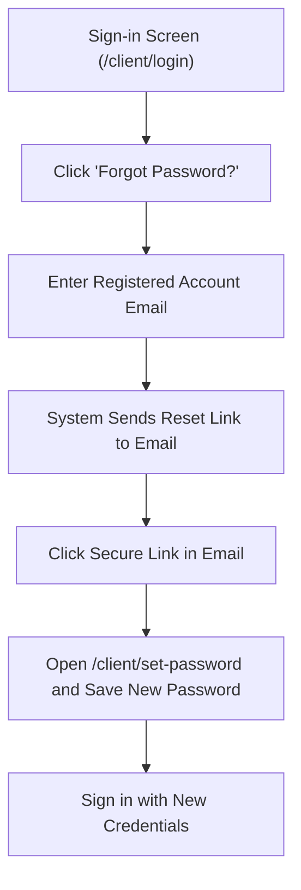

# Account Profile, Password Recovery, and Security

Maintaining accurate business contact details and robust password security ensures that official invoices, campaign notifications, and technical alerts are delivered securely to your team.

---

## Managing Your Account Profile

1. In the upper right corner of the dashboard, click on your profile avatar or initials.
2. Select **Account Settings** (or navigate to `/client/dashboard/profile`).
3. You can review and update:
   - **Primary Business Contact:** Full name of your designated account administrator.
   - **Notification Phone & WhatsApp:** Phone number used for automated onboarding notifications and broadcast alerts.
   - **Billing Address & City:** Registered corporate address printed on official tax invoices.
4. Click **Save Profile Changes**.

> [!NOTE]
> Legal entity names and registered GSTIN numbers cannot be edited self-service once verified. To request a corporate legal name change, submit a ticket in the [Tickets](/client/raising-support-tickets) section with your amended GST certificate.

---

## Changing Your Password

To update your portal password while logged in:

1. Open **Account Settings** and scroll to the **Security & Password** section.
2. Enter your **Current Password**.
3. Enter your **New Password** (minimum 10 characters, including letters, numbers, and symbols).
4. Re-enter the new password in the **Confirm New Password** field.
5. Click **Update Password**.
6. Your password is updated immediately across the web dashboard and mobile portal.

---

## Recovering Access: Forgot Password Flow

If you cannot sign in or have forgotten your credentials:

1. Navigate to the login portal at `/client/login`.
2. Click the **Forgot password?** link directly below the password input.
3. Enter your registered work email address and click **Send Reset Link**.
4. Check your inbox for the official password reset email from Amuwa.
5. Click the secure link, which opens the **Set New Password** screen (`/client/set-password`).
6. Enter and confirm your new password (minimum 10 characters).
7. Click **Set Password & Sign In**.

---

## Safe Sign-Out

When accessing the client portal on shared or public computers:

1. Click the **Sign Out** button (LogOut icon) at the bottom of the navigation sidebar.
2. The system terminates your authenticated session, clears browser local tokens, and redirects you to the secure login screen.
