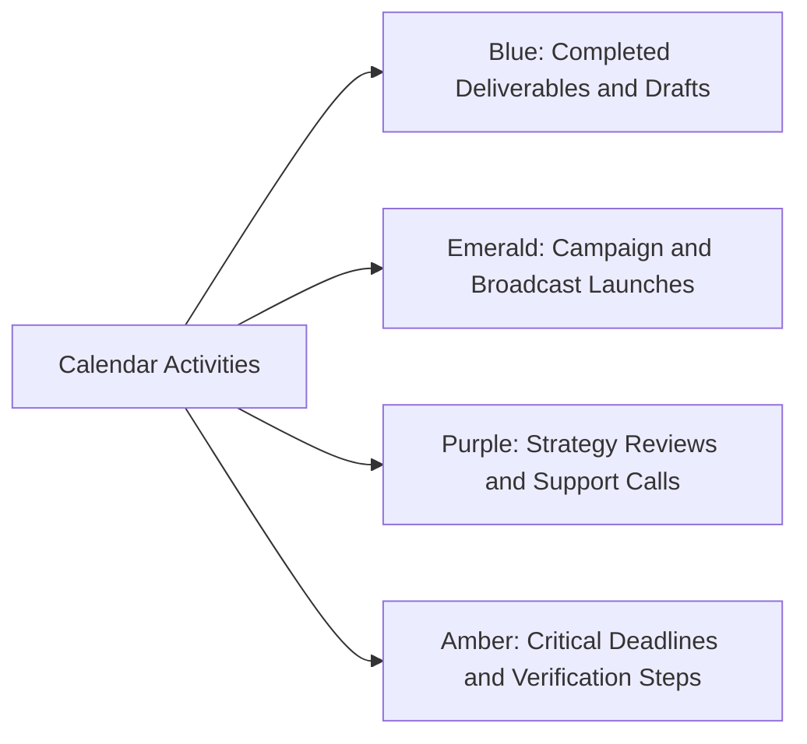

# How to Track Project Milestones on the Client Calendar

To keep your team informed of ongoing project progress without back-and-forth emails, the **Calendar** tab provides a real-time visual timeline of your active deliverables, campaign broadcasts, and scheduled strategy reviews.

---

## Navigating the Portal Calendar

1. Sign in to your dashboard and click **Calendar** (CalendarDays icon) in the navigation sidebar.
2. The calendar displays all scheduled activities across the current month.
3. Use the top toolbar to switch between **Month View**, **Week View**, or **List Agenda**.

---

## Activity Classifications and Color Indicators

| Activity Type | Badge Tone | Description |
| :--- | :--- | :--- |
| **Deliverable Completed** | Blue | Creative assets, approved templates, or chatbot scripts uploaded for your review. |
| **Campaign Launch** | Emerald | Scheduled WhatsApp promotional broadcasts or marketing campaign live dates. |
| **Scheduled Meeting** | Purple | Strategy consultation calls, onboarding kickoffs, or quarterly business reviews. |
| **Project Milestone** | Amber | Critical technical milestones such as Meta Verification submission or DNS setup. |

---

## Inspecting Activity Details and Deliverables

1. Click on any event badge on the calendar grid.
2. The **Event Detail Modal** opens, providing:
   - **Event Title & Time:** Exact date and scheduled execution time.
   - **Full Description:** Detailed notes logged by your assigned delivery engineer or Relationship Manager.
   - **Proof of Work / Attachments:** Direct links to preview delivered visual creatives, download documentation, or access meeting room video links.
   - **Assigned Specialist:** The Amuwa team member responsible for this deliverable.

---

## Requesting a Consultation Meeting

Need to schedule a review session with your Relationship Manager?

1. Click the **Schedule Review Call** button at the top-right of the calendar.
2. Select your preferred date, time slot, and discussion topics.
3. Click **Confirm Meeting Request**.
4. The event will appear immediately on your calendar once confirmed by your manager.
