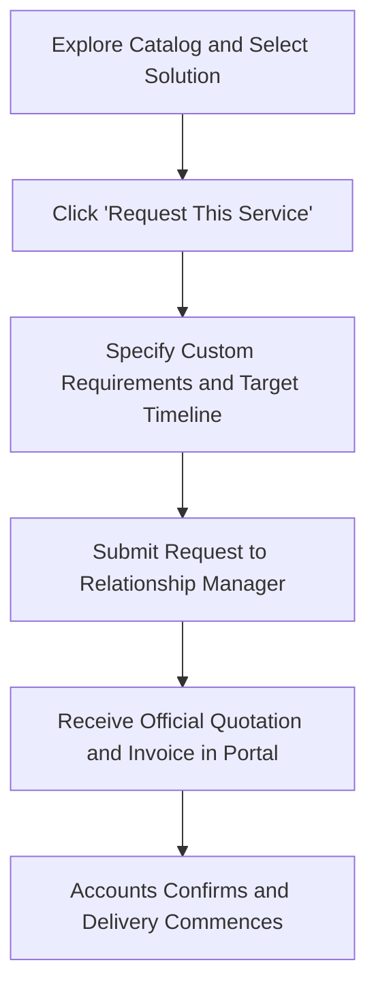

# How to Explore and Request New Services

As your enterprise expands, you may require additional capabilities—such as automated WhatsApp drip campaigns, custom interactive voice response (IVR) phone systems, e-commerce catalog integrations, or refreshed corporate branding.

The **Explore Services** section allows you to browse the complete suite of Amuwa Corporation solutions, inspect deliverable specifications, and submit requests directly to your account team.

---

## Browsing the Solution Catalog

1. Sign in to your portal and click **Explore Services** in the sidebar.
2. Use the category pills at the top to filter available offerings:
   - **All Solutions:** Comprehensive catalog view.
   - **WhatsApp & Meta Solutions:** Official API, Green Tick Verification, Chatbot Builders, Broadcast Automation.
   - **Branding & Design:** Logo Design, Social Media Kits, Brand Guidelines, Marketing Collateral.
   - **AI & Cloud Engineering:** Custom API Webhooks, Voice Agents, CRM Automation.
   - **Enterprise Telecom:** Virtual Calling Numbers, IVR Menus, SIP Trunking.

---

## Inspecting Solution Details

Click on any solution card to open the **Service Specification Modal**:

- **Core Capabilities:** Detailed breakdown of all included features and technical integrations.
- **Estimated Turnaround Time:** Standard delivery window (e.g., 5–7 business days).
- **Prerequisites:** What your team needs to provide (e.g., Meta Business Manager verification or vector logo files).
- **Pricing & Billing Cadence:** One-time deployment fees or monthly retainer options.

---

## Submitting a Service Request

### Step-by-Step Request Procedure

1. In the solution modal, click the blue **Request This Service** button.
2. In the request prompt:
   - **Notes / Specific Requirements:** Describe your specific project objectives or target audiences.
   - **Target Launch Date:** Specify your preferred completion deadline.
   - **Preferred Contact Method:** Select WhatsApp, Phone Call, or Email.
3. Click **Submit Request**.
4. Your dedicated Relationship Manager will receive the request instantly, review your account specifications, and provide an itemized proposal along with an official quotation in your [Invoices](/client/invoices-and-receipts) section.
