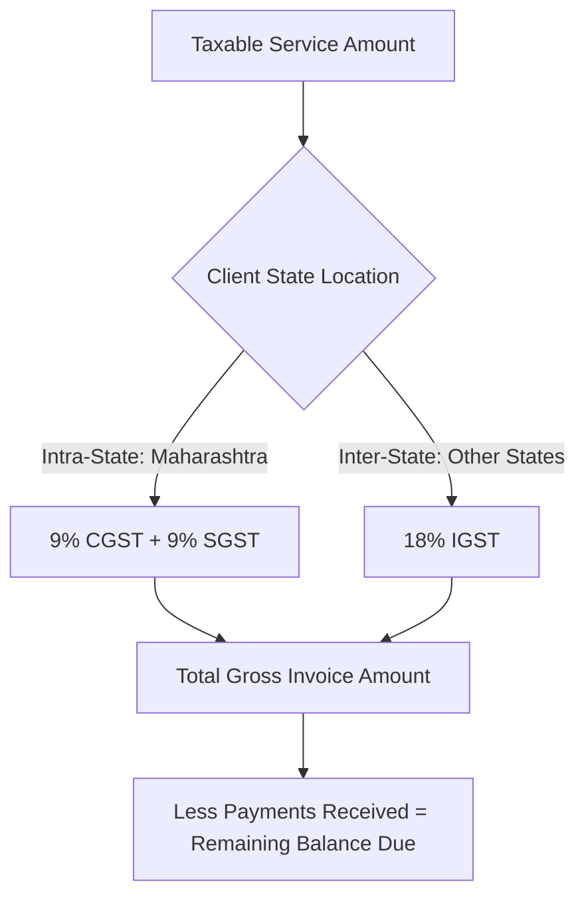

# How to Access Invoices and Download Tax Receipts

The **Invoices** module in your client portal provides transparent access to your complete billing history, itemized service charges, GST tax schedules, and downloadable official invoice receipts.

---

## Navigating Your Invoices Ledger

1. Sign in to your portal and select **Invoices** (FileText icon) in the navigation sidebar.
2. The page displays the **Billing Summary Overview**:
   - **Total Invoiced to Date:** Cumulative billed services across your account.
   - **Total Payments Settled:** Reconciled payments received and confirmed.
   - **Current Outstanding Balance:** Any unpaid or partially paid balance due.
3. Below the summary, the **Invoice Records Table** lists all individual billing statements in chronological order.

---

## Understanding Invoice Statuses

Each invoice in the table displays an official status indicator:

| Status Badge | Style | Description |
| :--- | :--- | :--- |
| **Paid** | Green | Payment fully received, reconciled, and verified. Includes official stamped seal on PDF. |
| **Partially Paid** | Orange | A milestone or deposit payment was recorded; remaining balance is pending. |
| **Issued / Unpaid** | Amber | Invoice generated and issued; awaiting payment settlement. |

---

## Understanding GST and Itemized Charges

Amuwa invoices are fully compliant with Indian Goods & Services Tax (GST) regulations:

- **Taxable Amount:** Net value of services rendered prior to statutory taxation.
- **SAC Codes:** Standardized 6-digit Service Accounting Codes (e.g., `998314` for IT & Automation).
- **Tax Breakdown:**
  - **Inter-State Transactions:** Charged at 18% Integrated GST (`IGST`).
  - **Intra-State Transactions:** Split equally into 9% Central GST (`CGST`) and 9% State GST (`SGST`).
- **Total Amount:** Gross figure payable including all statutory taxes.

---

## Downloading Official Invoice PDFs

You can download an official, audit-ready PDF for any invoice at any time:

1. Locate the invoice row in the table.
2. Click the **Download PDF** button (with the download arrow icon).
3. The system generates and downloads an ultra-compact (<500 KB) PDF statement featuring:
   - Official Amuwa Corporation branding, registered office address, and GSTIN.
   - Client legal business name, address, and GSTIN.
   - Itemized service breakdown with SAC codes, quantities, and rates.
   - Official bank NEFT/RTGS wire details and UPI payment coordinates.
   - For settled bills: an authenticated green **PAID** seal with payment confirmation reference numbers.
