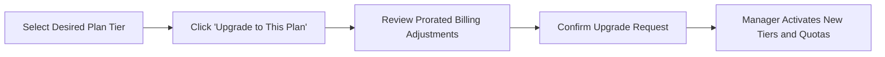

# How to Manage Monthly Retainer Plans and Upgrades

Ongoing digital marketing campaigns, server maintenance, and multi-agent customer support operate under predictable monthly subscription plans. The **Monthly Plans** tab provides full transparency into your active retainer tier, renewal schedules, and available tier upgrades.

---

## Viewing Your Active Plan

1. In the portal navigation sidebar, click **Monthly Plans** (Sparkles icon).
2. The top banner highlights your **Active Subscription**:
   - **Current Plan Tier:** E.g., *Wabastore Growth Tier* or *Design Studio Retainer*.
   - **Monthly Billing Amount:** Net monthly investment including applicable GST.
   - **Next Renewal Date:** Automatic billing or invoice generation date.
   - **Included Monthly Quotas:** Monthly conversation credits, design revisions, or scheduled strategy sessions.

---

## Comparing Plan Tiers

Below your active subscription, the portal provides an interactive side-by-side **Plan Comparison Grid**:

| Feature / Quota | Starter Tier | Growth Tier (Most Popular) | Enterprise Tier |
| :--- | :--- | :--- | :--- |
| **WhatsApp Monthly Credits** | 10,000 Conversations | 50,000 Conversations | Unlimited / Custom Scale |
| **Support SLA** | 24-Hour Email Support | 4-Hour Priority WhatsApp | 1-Hour Dedicated Hotline |
| **Design Revisions** | 2 per Month | 8 per Month | Unlimited On-Demand |
| **Dedicated Manager** | Shared Support Desk | Assigned Relationship Mgr | Senior Technical Lead |
| **Monthly Analytics Review** | Self-Service Dashboard | Bi-Weekly Strategy Call | Weekly Executive Review |

---

## Requesting a Plan Upgrade or Switch

### Step-by-Step Procedure

1. In the comparison grid, locate your desired new tier.
2. Click **Upgrade to This Plan** (or **Switch to This Plan**).
3. In the confirmation dialog:
   - Review the effective start date (immediately with prorated billing or starting next billing cycle).
   - Enter any optional comments for your account manager.
4. Click **Confirm Plan Request**.
5. Your Relationship Manager will adjust your account quotas and deliver an updated subscription confirmation invoice to your [Invoices](/client/invoices-and-receipts) ledger.
