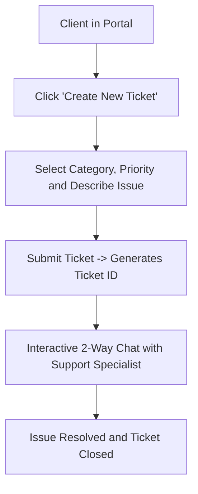

# How to Raise Support Tickets and Chat with Support

When you encounter technical hurdles, need configuration assistance, or have billing inquiries, the **Tickets** module connects you directly to our dedicated customer success engineers and your assigned Relationship Manager.

---

## Opening a New Support Ticket

### Step-by-Step Procedure

1. Sign in to your portal and click **Tickets** (LifeBuoy icon) in the navigation sidebar.
2. Click the blue **Create New Ticket** button at the top-right.
3. Complete the ticket creation form:
   - **Ticket Subject:** A brief summary of your request (e.g., *"Assistance updating WhatsApp webhook endpoint"*).
   - **Category:** Select `TECHNICAL`, `BILLING`, `ONBOARDING`, `SERVICE_REQUEST`, or `GENERAL`.
   - **Priority Level:** Choose `LOW`, `NORMAL`, `HIGH`, or `URGENT` (reserve Urgent for complete service outages).
   - **Detailed Description:** Provide specific context, including error messages, steps to reproduce, or transaction IDs.
   - **Attachments:** Attach screenshots or error logs (up to 2 MB per file).
4. Click **Submit Ticket**.
5. The system generates a unique tracking number (e.g., `#AMW-0042`) and routes the ticket directly to your support team.

---

## Two-Way Interactive Ticket Chat

Once a ticket is created, clicking on it opens the interactive **Ticket Chat Workspace**:

- **Real-Time Messaging:** Send messages and receive replies without refreshing your browser.
- **Delivery & Read Receipts:** Sent and seen double-check indicators confirm when a support specialist has read your message.
- **File Sharing:** Upload replacement screenshots or documentation directly into the conversation thread.
- **Dedicated Specialist:** The header displays the name and photo of the support engineer or Relationship Manager actively handling your ticket.

---

## Understanding Ticket Statuses

Your ticket list tracks the live progression of each inquiry:

| Status Badge | Style | Description |
| :--- | :--- | :--- |
| **Open** | Blue | Newly created ticket; assigned to queue. |
| **In Progress** | Indigo | A specialist is actively investigating or implementing a solution. |
| **Waiting on Client** | Amber | Support has replied and requested additional details or confirmation from you. |
| **Resolved** | Green | The issue has been addressed and confirmed operational. |
| **Closed** | Slate | Ticket inquiry concluded and archived. |

---

## Reopening a Resolved Ticket

If an issue recurs after being marked **Resolved**:

1. Open the resolved ticket from your ticket history.
2. Type a message in the chat input explaining that the problem persists.
3. Click **Send Message**.
4. The ticket automatically reopens to **In Progress** and alerts your assigned support engineer.
