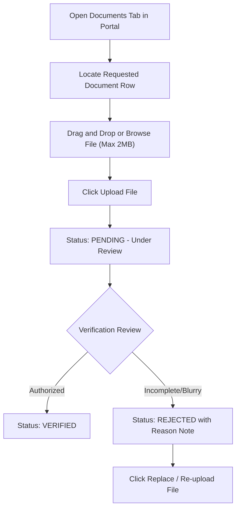

# How to Upload and Manage Verification Documents

Certain official services-such as Meta WhatsApp Official Business API verification, telecom integrations, and company invoicing-require verified legal documentation.

The **Documents** tab serves as your secure, encrypted vault for submitting requested compliance files and tracking their review status.

---

## Document Requirements and File Guidelines

To ensure rapid verification without delays, please observe the following standards:

- **Accepted Formats:** PDF (`.pdf`), JPEG (`.jpg`, `.jpeg`), and PNG (`.png`).
- **Maximum File Size:** Strictly **2 MB per file**. Compress larger PDFs prior to upload.
- **Visual Quality:** Ensure scans are in full color, completely legible, and display all corners without watermarks or obstructions.
- **Validity:** Business registrations (GST, Udyam, Certificate of Incorporation) must match your company name exactly.

---

## Step-by-Step Procedure: Uploading a Document

### 1. Locate the Required Document Row

1. Sign in to your portal and click **Documents** (FolderUp icon) in the navigation menu.
2. The page displays the checklist of required verification files (e.g., *GST Certificate*, *Company PAN Card*, *Business Address Proof*).
3. Rows marked with a red asterisk (`*`) are mandatory for service provisioning.

---

### 2. Upload Your File

1. Click the **Upload File** button (or drag and drop your file directly onto the upload dropzone).
2. Select your file from your computer or mobile device.
3. Review the preview thumbnail and confirmed file size.
4. Click **Confirm Upload**.
5. The file is encrypted and securely transmitted to Amuwa's private document storage repository.

---

## Understanding Document Review Statuses

Once uploaded, your file displays one of three status badges:

| Status Badge | Style | Description | Action Required |
| :--- | :--- | :--- | :--- |
| **Under Review** | Amber | File submitted successfully; awaiting verification team inspection. | None. Verification typically completes within 24–48 hours. |
| **Verified** | Green | File inspected and authorized as authentic and valid. | Completed. No further action needed. |
| **Needs Re-upload** | Red | File rejected due to legibility or validity issues. | Read the reviewer's reason note and upload a corrected file. |

---

## How to Correct a Rejected Document

If a document displays **Needs Re-upload**:

1. Click on the document row to view the reviewer's specific feedback note (e.g., *"Page 2 of GST Certificate is truncated and unreadable"*).
2. Prepare a corrected, high-resolution replacement file adhering to the reviewer's instructions.
3. Click the **Re-upload Document** button on the row.
4. Select the new file and submit. The status immediately returns to **Under Review**.
