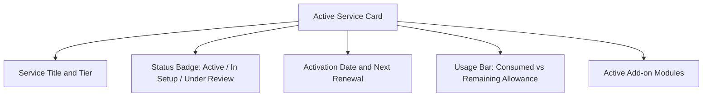

# How to View Active Services and Track Quota Usage

The **My Services** section of your client portal provides complete visibility into every digital solution, automation tier, and creative package purchased from Amuwa Corporation.

---

## Accessing Your Services

1. Sign in to your portal at `/client/login`.
2. In the left navigation menu, click **My Services** (Package icon).
3. The page displays your active subscriptions grouped by category:
   - **WhatsApp Marketing & Automation** (e.g., Meta Official API, Blue Tick Verification).
   - **Creative & Design Solutions** (e.g., Brand Identity Kits, Social Media Retainers).
   - **Software & Cloud Solutions** (e.g., Conversational AI Chatbots, Custom Webhooks).

---

## Understanding Service Cards and Details

Each service card displays key operational metrics:

- **Service Status Badge:**
  - **Active (Green):** Fully provisioned, operational, and handling live traffic.
  - **In Setup / Under Review (Amber):** Verification documents are undergoing review or technical configurations are being deployed.
  - **Renewing Soon (Orange):** Subscription expiring within 14 days.
- **Service Specs:** Technical parameters such as provisioned WhatsApp Business Account (WABA) IDs, connected phone numbers, and webhook destinations.
- **Account Manager:** Name and contact details of your assigned Relationship Manager.

---

## Monitoring Usage Bars and Allowances

For communication and broadcast services with volume-based pricing:

1. Locate the **Usage & Quotas** section on the service card.
2. The visual progress bar indicates:
   - **Total Package Quota:** Total messages or service credits included in your billing cycle.
   - **Consumed Volume:** Messages delivered during the active month.
   - **Remaining Balance:** Available quota remaining before top-up.
3. If your consumption approaches 80% of allowed bandwidth, the usage bar transitions to amber to ensure you have sufficient time to request a top-up.

---

## Requesting Quota Top-Ups

When your usage nears package limits:

1. Click the **Request Additional Credits** or **Explore Add-ons** button directly on the service card.
2. Select your desired credit tier (e.g., 25,000 additional WhatsApp conversations).
3. Confirm the request. Your Relationship Manager will immediately contact you with pricing confirmation and activate the supplemental credits.
