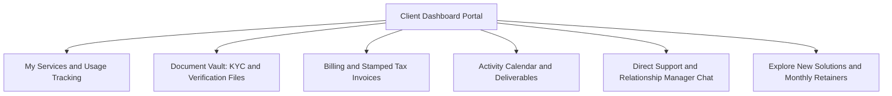

# Welcome to the Amuwa Client Portal

Welcome to the **Amuwa Client Portal** (`/client/dashboard/overview`)—your centralized self-service hub for managing all your digital services, tracking active marketing campaigns, uploading verification documents, downloading official invoices, and communicating directly with your dedicated support team.

---

## What You Can Do in Your Portal

- **Monitor Service Usage:** View active subscriptions, remaining WhatsApp message credits, and renewal dates in real time.
- **Access Official Invoices:** View itemized bills and download stamped GST tax receipts with a single click.
- **Upload Verification Documents:** Submit business documents, logos, and licenses securely without email delays.
- **Track Campaign Deliverables:** View upcoming launches, milestone deliveries, and team meetings on your interactive calendar.
- **Get Dedicated Assistance:** Open priority support tickets and chat directly with your assigned Relationship Manager.

---

## Navigating Your Dashboard

When you sign in to your dashboard at `/client/login`, the left-hand navigation sidebar provides seamless access to key modules:

| Section | Icon | Purpose |
| :--- | :--- | :--- |
| **Overview** | `LayoutDashboard` | High-level summary of active services, recent deliverables, and announcements. |
| **My Services** | `Package` | Detailed breakdown of active solutions, API quotas, and service specifications. |
| **Campaigns** | `Megaphone` | Real-time status of marketing broadcasts, promotional campaigns, and audience reaches. |
| **Explore Services** | `Search` | Catalog of available digital solutions, add-ons, and conversational automation tools. |
| **Monthly Plans** | `Sparkles` | Retainer tiers, monthly support packages, and self-service plan upgrades. |
| **Calendar** | `CalendarDays` | Visual timeline of deliverables, scheduled meetings, and milestone launches. |
| **Documents** | `FolderUp` | Secure repository for uploading KYC verification files, brand assets, and certificates. |
| **Invoices** | `FileText` | Complete billing ledger, issued statements, and paid GST tax invoice PDFs. |
| **Tickets** | `LifeBuoy` | Interactive support desk and direct messaging thread with support engineers. |
| **Notification Center** | `Bell` | Real-time updates regarding service milestones, invoice releases, and ticket replies. |

---

## Getting Started in 3 Quick Steps

1. **Complete Document Uploads:** Open the [Documents](/client/uploading-client-documents) tab to verify your business identity and submit any pending setup materials.
2. **Review Your Invoices:** Visit the [Invoices](/client/invoices-and-receipts) section to download tax receipts for your accounting records.
3. **Connect with Support:** If you have questions regarding your services, submit a ticket in the [Tickets](/client/raising-support-tickets) section to connect with your support team.
