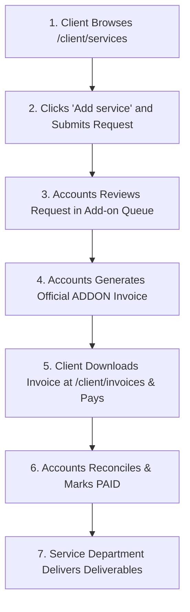

The **Client Portal Purchase Journey** provides self-service expansion for verified Amuwa clients. Rather than relying on manual telephone callbacks or ad-hoc messaging, clients can browse the active catalog of communication and marketing solutions directly within their authenticated portal, submit formal purchase inquiries, track invoice issuance, and monitor service activation.

---

## The End-to-End Self-Service Lifecycle

---

## Step-by-Step Breakdown

### Stage 1: Catalog Discovery in the Client Dashboard

1. The customer authenticates at `/client/login` using their registered email and secure password.
2. In the Client Portal top navigation, they click **Services** (`/client/services`).
3. The catalog displays active service offerings:
   - **Official WhatsApp Business API (Wabastore):** Enterprise messaging, green badge assistance, multi-agent inbox.
   - **Whatsbox Broadcast Engine:** Mass notifications, automated campaigns, and customer retargeting.
   - **BolifyAI Voice Calling (D Talk):** Smart conversational AI agents, inbound/outbound automated voice flows.
   - **AI Business Website (Digitree Infotech):** Modern fast web portals and digital catalogs.
   - **Brand Identity & Graphics (Amuwa Design Studio):** Professional logos, social media banners, and video assets.

---

### Stage 2: Submitting an Add-on Request

1. For any service the client does not currently have active, they click the blue **Add service** button.
2. A request modal prompts the client for preliminary details:
   - Specific requirements (e.g., number of voice minutes, number of WhatsApp agents).
   - Preferred kickoff timeline.
3. Upon clicking **Submit Request**, the CRM logs an add-on proposal record.
4. The service card immediately updates to show a grey badge: **Requested / In Review**.

---

### Stage 3: Accounts Review and Invoicing

1. The request instantly notifies the **Accounts Department** in the internal CRM.
2. An Accounts officer opens **Add-ons Services**, checks the customer's payment history, and confirms margin and tax applicability.
3. Accounts clicks **Issue Invoice**, generating a sequential `ADDON` invoice with standard HSN/SAC codes and 18% GST.

---

### Stage 4: Payment and Document Fulfillment

1. The client navigates to **Invoices** (`/client/invoices`) in their portal.
   
2. The client downloads the official PDF statement, reviews payment terms, and executes payment via bank transfer or gateway.
3. Once Accounts verifies the incoming funds, the invoice status changes to **Paid**, and the service moves to active delivery.
4. If technical setup items or brand assets are needed, the client uploads them in **Documents** (`/client/documents`).
