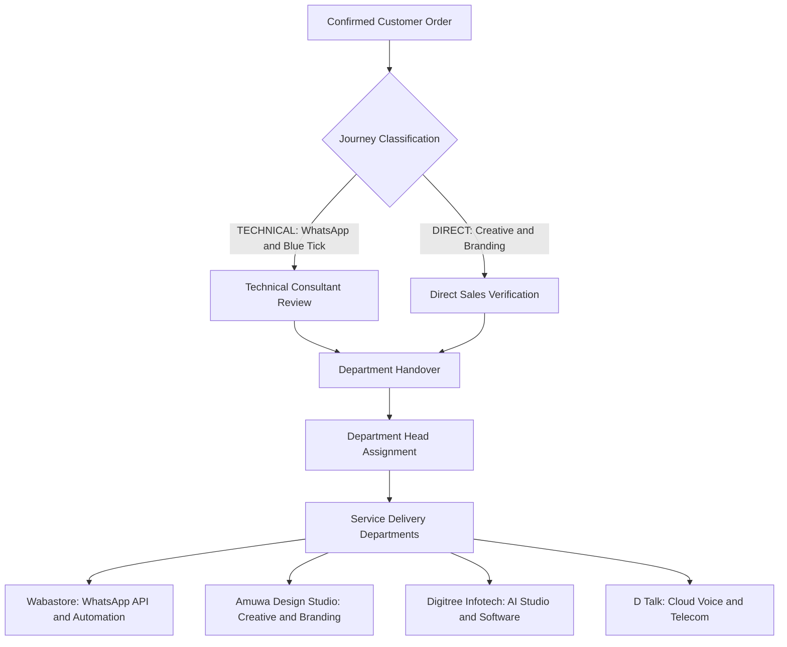

# Service Delivery Departments Overview

In Amuwa AI CRM, once a client order is confirmed by Accounts and verified through onboarding, fulfillment transitions to dedicated **Service Delivery Departments**. Each department specializes in distinct technical capabilities, creative deliverables, or managed communication infrastructure.

---

## Service Delivery Ecosystem

---

## Core Delivery Departments and Capabilities

### 1. Wabastore (E-Commerce & Omnichannel Automation)
- **Primary Domain:** Meta Official WhatsApp Business API, green badge/blue tick verification, conversational automation, and omnichannel retail bots.
- **Workflow Path:** Mandatory `TECHNICAL` journey with Technical Consultant checklist verification and automated client onboarding messaging.
- **Key Deliverables:** WABA ID provisioning, approved display name, interactive message templates, webhook routing, and multi-agent inbox setup.

---

### 2. Amuwa Design Studio (Creative & Branding Solutions)
- **Primary Domain:** Brand identity kits, vector logos, UI/UX mockups, social media advertising creatives, packaging design, and visual marketing assets.
- **Workflow Path:** `DIRECT` journey bypassing Technical Consultant. Accounts provisions client login, Sales verifies creative briefs/assets, and transfers directly to Design Studio specialists.
- **Key Deliverables:** Figma workspaces, high-resolution vector brand assets, brand style guides, and print-ready creative files.

---

### 3. Digitree Infotech & AI Studio (Software & Conversational AI)
- **Primary Domain:** Custom software development, conversational AI agents, CRM integration webhooks, and enterprise cloud infrastructure.
- **Workflow Path:** Hybrid technical onboarding with custom API scoping, database provisioning, and automation pipeline integration.
- **Key Deliverables:** Custom API endpoints, AI agent system prompts, webhook middleware, and cloud deployment pipelines.

---

### 4. D Talk Corporation (Enterprise Telecom & Cloud Voice)
- **Primary Domain:** Cloud telephony, interactive voice response (IVR) systems, SIP trunking, and call center analytics.
- **Workflow Path:** Telecom compliance verification, DID number mapping, and virtual PBX routing configuration.
- **Key Deliverables:** Virtual phone numbers, IVR call trees, agent extension routing, and call recording integrations.

---

## Shared Operational Principles

1. **Role-Based Work Isolation:** Delivery engineers and team members only see client dossiers assigned to their department and team, preventing unauthorized access across corporate entities.
2. **Transparent Client Activity Logging:** Delivery milestones, proof-of-work files, and progress notes logged by delivery staff synchronize to the **Client Dashboard Activity Calendar** (`/client/calendar`).
3. **Escalation Support Integration:** If a client encounters delivery hurdles, incoming support tickets categorized as `TECHNICAL` or `SERVICE_REQUEST` link directly to the responsible delivery team lead for swift resolution.
