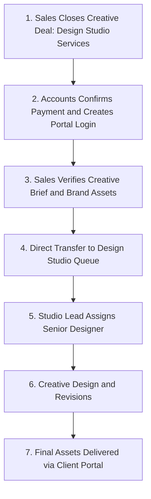

# Amuwa Design Studio Direct Delivery Workflow

Amuwa Design Studio provides creative solutions, strategic brand identity development, UI/UX design, and marketing collateral. Unlike technical software and WhatsApp API integrations, creative projects follow the **DIRECT delivery pathway** to ensure rapid turnaround without unnecessary technical overhead.

---

## Direct Workflow Architecture

---

## Key Differences from Technical Journeys

| Milestone | Technical WhatsApp / Bot Journey | Design Studio Direct Journey |
| :--- | :--- | :--- |
| **Technical Consultant Role** | Mandatory review, WABA ID provisioning | **Completely Bypassed** |
| **Client Portal Provisioning** | Created by Technical Consultant | **Created by Accounts during payment confirmation** |
| **Document / Brief Verification** | Authorized by Technical Consultant | **Verified directly by Sales in Checklist Panel** |
| **Handoff Destination** | TC -> Dept Head -> Team Lead | **Sales -> Design Studio Delivery Queue** |

---

## Step-by-Step Delivery Procedure

### 1. Ingestion and Assignment

1. The Design Studio Department Head or Creative Team Lead monitors the **Design Studio Intake Queue**.
2. Customers with confirmed `DS_*` services appear immediately once Sales marks their creative checklist as verified.
3. The Team Lead reviews the project brief:
   - Target audience and brand positioning.
   - Vector logo requirements, color preferences, and typography guidelines.
   - Reference websites or inspiration mood boards.
4. The Team Lead assigns the account to a designated visual designer.

---

### 2. Design Production and Collaboration

1. The assigned designer reviews the submitted brand assets in the customer dossier.
2. Production commences in Figma / Illustrator according to company design standards.
3. If clarification is needed regarding the brief, the designer logs an internal inquiry for the sales representative or communicates via the customer's linked support thread.

---

### 3. Sharing Drafts and Iterations

1. When initial drafts (e.g., logo concepts or UI wireframes) are ready:
   - The designer logs a deliverable on the **Client Activity Calendar**, specifying the review milestone.
   - Draft files (under 2 MB per file) or shared design cloud links are uploaded to the customer record.
2. The client reviews the drafts in their portal and provides structured feedback.

---

### 4. Final Delivery and Archive

1. Once the client approves the final design:
   - Prepare the comprehensive brand package: high-resolution PNGs, SVGs, source vector files (AI/EPS), brand guidelines PDF, and font licenses.
   - Upload finalized package assets to the customer's secure storage repository.
2. Mark the delivery status as **Completed**.
3. Send an automated project closure notification to the client inviting them to explore recurring social media retainer packages.
