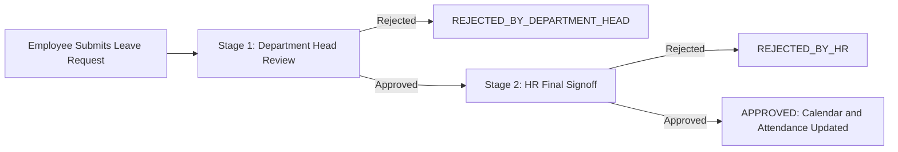

# How to Review and Approve Departmental Leave Requests

Amuwa AI CRM enforces a structured, two-tier approval workflow for employee leave requests. Before any leave is finalized by Human Resources, the applicant's **Department Head** must conduct a first-stage operational review to ensure adequate coverage and project continuity.

---

## Two-Tier Leave Approval Architecture

---

## Prerequisites

- You must be logged in as an authorized **Department Head**.
- The leave request must have been submitted by a team member or team lead within your assigned department.
- The request must currently be in status **Pending Department Head Approval** (`PENDING_DEPARTMENT_HEAD`).

---

## Step-by-Step Approval Procedure

### 1. Open the Leave Approval Center

1. In your dashboard, open the **Leave Management** tab (or navigate to `/leave/approvals`).
2. The queue displays all active leave applications submitted by members of your department.
3. Requests requiring your immediate decision are highlighted with an amber badge: **Pending Department Head Approval**.

---

### 2. Inspect the Leave Application Details

1. Click on the leave request card to inspect the application details:
   - **Applicant Name & Designation:** E.g., *"Ananya Verma — WhatsApp Integration Specialist"*.
   - **Leave Type:** Casual Leave (CL), Sick Leave (SL), Earned Leave (EL), or Unpaid Leave.
   - **Duration & Schedule:** Full day or Half day (Morning / Afternoon) and specific date range.
   - **Applicant Reason:** Detailed explanation submitted by the employee.
   - **Current Leave Balance:** Remaining annual quotas for the employee.
   - **Current Team Coverage:** Number of team members actively on duty during the requested window.

---

### 3. Approving the Request (Advancing to HR)

1. If departmental staffing and ongoing project deliverables are safeguarded:
2. Click the green **Approve Request** button.
3. Enter an optional operational note (e.g., *"Coverage arranged with Suresh; project milestones not impacted"*).
4. Click **Confirm Approval**.
5. The request status updates to **Pending HR Approval** (`PENDING_HR`), transferring the application to the HR Department queue for final signoff.

---

### 4. Rejecting the Request

1. If the requested leave coincides with critical client deployment deadlines or creates severe staffing shortages:
2. Click the red **Reject Request** button.
3. Enter a mandatory rejection reason explaining the operational constraint (e.g., *"Cannot approve due to 2 concurrent launches scheduled for Wabastore retail client"*).
4. Click **Confirm Rejection**.
5. The request transitions immediately to **Rejected by Department Head** (`REJECTED_BY_DEPARTMENT_HEAD`).
6. A notification containing your rejection reason is dispatched to the applicant.
