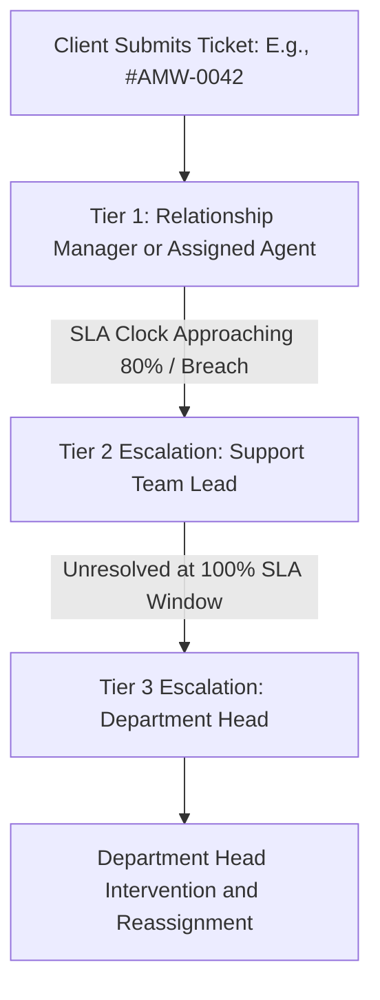

# Department Ticket SLAs and Escalation Management

Prompt customer support is vital to client retention. Amuwa AI CRM incorporates an automated Service Level Agreement (SLA) engine that tracks ticket response clocks and automatically escalates neglected issues across a 3-tier management hierarchy.

Department Heads oversee department-wide ticket volumes, calibrate SLA parameters, and take direct action on **Tier-3 escalated tickets**.

---

## The 3-Tier Escalation Hierarchy

- **Tier 1 (Frontline Agent):** Primary Relationship Manager or delivery specialist assigned to the client account.
- **Tier 2 (Team Lead):** Receives escalated notification when first response SLA exceeds 80% of allowed threshold without action.
- **Tier 3 (Department Head):** Escalated when total SLA window breaches, flagging urgent leadership intervention.

---

## Automated Background SLA Monitoring

The CRM runs an automated background evaluation process **every 5 minutes**:

1. Scans all tickets in statuses `OPEN`, `WAITING_ON_US`, or `IN_PROGRESS`.
2. Compares `last_client_message_at` against the department's configured `sla_hours`.
3. If elapsed time exceeds the SLA threshold and the ticket has not been acknowledged, updates the ticket status to `ESCALATED` and alerts the Department Head.

---

## Supervising Escalations on the Department Head Dashboard

### 1. Accessing Escalated Tickets

1. Open the **Support & Tickets** module in your dashboard.
2. In the ticket filter tabs, click **Escalated (`ESC`)**.
3. The queue displays all unresolved tickets requiring managerial intervention, highlighted with pulsing red SLA breach timers.

---

### 2. Inspecting Ticket Thread and History

1. Select an escalated ticket to open the **Two-Panel Ticket Workspace**:
   - **Left Panel:** Client business profile, purchased services, SLA timer countdown, and assigned agent.
   - **Right Panel:** Interactive conversation history between the client and support agents.
2. Review yellow **Internal Notes** to understand why previous agents were unable to resolve the inquiry.

---

### 3. Department Head Interventions

As Department Head, you have three primary intervention actions:

1. **Post Internal Directive (Staff-Only Note):**
   - Click the note icon in the chat input.
   - Post an internal instruction tagged `#INTERNAL_NOTE` (e.g., *"Contacting Meta partner representative directly; pause external client messages"*).
   - Visible exclusively to internal staff; hidden from the client portal.
2. **Reassign Ticket:**
   - In the left sidebar, click **Reassign Agent**.
   - Select a senior engineer or alternate team lead to take immediate ownership.
3. **Direct Client Response:**
   - Send an authoritative leadership reply directly to the client, assuring them of priority resolution.

---

## Configuring Department SLA Standards

Department Heads collaborating with Super Admins can adjust standard SLA response benchmarks based on service complexity:

| Service Category | Standard SLA Target | Critical Priority SLA |
| :--- | :--- | :--- |
| **Wabastore WhatsApp API Outages** | 2 Hours | 30 Minutes |
| **General Technical Queries** | 8 Hours | 2 Hours |
| **Billing and Invoice Inquiries** | 24 Hours | 4 Hours |
| **Creative Revisions (Design Studio)** | 24 Hours | 8 Hours |

To request updates to department-wide SLA thresholds, submit a configuration request to Super Admin via Administrative Settings.
