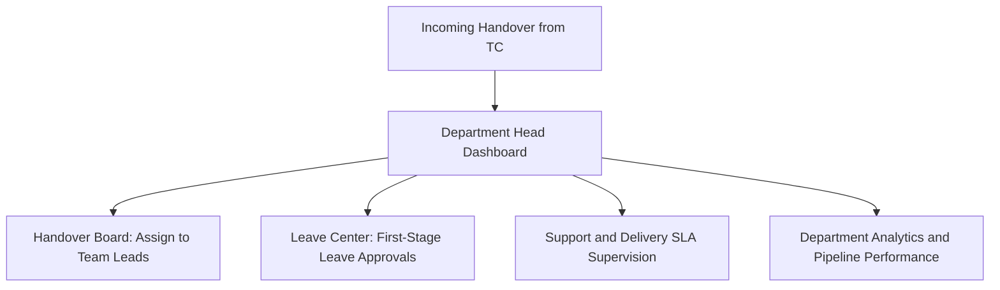

# Department Head Guide: Roles, Responsibilities, and Oversight

In Amuwa AI CRM, the **Department Head** (`DEPARTMENT_HEAD`) serves as the senior operational leader for a dedicated business division (such as Wabastore, Support, Accounts, HR, or Design Studio).

Department Heads oversee incoming client accounts transferred from Technical Consultants, distribute operational workloads to Team Leads, approve staff leave applications, and supervise team performance and ticket SLA compliance.

---

## Department Head Core Responsibilities

1. **Client Handover Distribution:** Receive verified customer accounts from Technical Consultants and route them to competent Team Leads via the **Handover Board**.
2. **Team Operational Oversight:** Supervise Team Leads and Team Members, track project completion rates, and balance caseloads.
3. **Leave Management:** Review first-stage leave requests submitted by departmental staff before escalating to HR.
4. **SLA and Ticket Escalations:** Supervise ticket resolution clocks and address Tier-3 automated ticket escalations.

---

## Navigating the Department Head Dashboard

When a Department Head signs in, the interface loads the departmental workspace:

- **Top Stat Cards:**
  - **Incoming Accounts to Assign:** Verified customers waiting for team lead allocation.
  - **Active Workloads:** Customers actively in delivery across team rosters.
  - **Pending Leaves:** Departmental leave requests awaiting review.
  - **SLA Breach Alerts:** Overdue customer tickets or delivery milestones.
- **Navigation Tabs:**
  - **Clients & Handovers (`/handover`):** The interactive Kanban board tracking account transitions.
  - **Staff Roster:** View all Team Leads and Team Members belonging to your division.
  - **Leave Approvals:** First-stage authorization queue.
  - **Tickets & Support:** Escalation queues and department response metrics.

---

## Permissions and Boundaries

| Action | Department Head Permission |
| :--- | :--- |
| **Pass Customer to Team Lead** | Authorized (within assigned department) |
| **Reassign Team Lead** | Authorized |
| **Inspect Checklist & Consultation Notes** | Authorized (Read-only) |
| **Approve / Reject Department Leave** | Authorized (Stage 1; forwards to HR) |
| **Direct Production Database Edits** | Unauthorized (Strictly restricted) |
| **Access Other Independent Departments** | Restricted by divisional isolation |
| **Issue Financial Invoices** | Restricted to Accounts Department |
