Every customer record in Amuwa AI CRM tracks several independent status dimensions simultaneously: where the customer sits in the overall lifecycle (`CustomerStage`), how warm the sales conversation is (`LeadStatus`), how much money has been verified (`PaymentStatus` and `AccountsConfirmationStatus`), where onboarding handover stands (`HandoverStage`), and the health of active delivery (`ClientStatus`).

## Before you start

:::prereq
- Status transitions are enforced by the backend API and database triggers. Certain transitions (such as moving from `POTENTIAL` to `ONBOARDING` or enabling `Get Started`) unlock automatically only when financial or document prerequisites are satisfied.
:::

## End-to-end status progression diagram

```mermaid
flowchart LR
  subgraph Stage1["1. LEAD"]
    L1["NEW / ATTEMPTED_TO_CONTACT"] --> L2["CONNECTED / QUALIFIED"]
    L2 --> L3["DEMO_SCHEDULED / PROPOSAL_SENT"]
    L3 --> L4["READY_TO_BUY"]
  end
  subgraph Stage2["2. POTENTIAL"]
    P1["AccountsConfirmation: NONE"] --> P2["PENDING (Confirm Payment)"]
    P2 --> P3["CONFIRMED (Payment Verified)"]
    P2 -.-> P4["REJECTED (Returned)"]
  end
  subgraph Stage3["3. ONBOARDING"]
    O1["6 Checklist Items + Payment + Invoice"] --> O2["Get Started Enabled"]
    O2 --> O3["Handover:READY_FOR_DELIVERY"]
  end
  subgraph Stage4["4. CLIENT"]
    C1["Handover: HANDED_OVER"] --> C2["ClientStatus: ACTIVE"]
    C2 --> C3["RENEWAL_DUE / ON_HOLD / CHURNED"]
  end
  L4 --> P1
  P3 --> O1
  O3 --> C1
```

## 1. Customer Lifecycle Stage (`CustomerStage` / `LifecycleStage`)

Displayed in the left sidebar under **My Leads** and **Team Leads** (`1 Leads`, `2 Potential`, `3 Customer onboarding`, `4 Client`):

| Stage Enum | Sidebar Tab | Meaning & Entry Criteria |
| --- | --- | --- |
| `LEAD` | **1 Leads** | Initial prospect created manually, scanned via **ShopPhotoScan** OCR, imported via CSV/Excel, or handed over from a Telecaller (`Sent to BA`). |
| `POTENTIAL` | **2 Potential** | Commercial intent established. Customer moves here automatically when `LeadStatus` is set to `READY_TO_BUY` (or manually via **Send to Potential**) with selected services and an agreed deal value. |
| `ONBOARDING` | **3 Customer onboarding** | Accounts has confirmed the customer's payment (`CONFIRMED`), or a Technical Consultant has initiated onboarding from the direct intake queue. Sales and Technical Consultants collect and verify the 6 mandatory checklist items here. |
| `CLIENT` (`CUSTOMER`) | **4 Client** | Onboarding and department handover (`HANDED_OVER`) are complete, or the customer was migrated via the **One-Sheet Existing Customer Import**. Active service delivery and retention management take place here. |

## 2. Lead Qualification Status (`LeadStatus`)

Used in **1 Leads**, Telecaller calling sheets, and Business Associate pipelines to track outreach progress:

| Status Code | Category | When to Use |
| --- | --- | --- |
| `NEW` | Initial | Newly created, imported, or assigned lead with no outreach logged yet. |
| `ATTEMPTED_TO_CONTACT` | Outreach | Outbound call or WhatsApp message attempted, but the prospect did not answer. |
| `CONNECTED` (`CONTACTED`) | Outreach | Spoke with the decision-maker and introduced Amuwa services. |
| `CALLBACK` | Follow-up | Prospect requested a callback at a specific date and time (`Next follow-up`). |
| `QUALIFIED` (`INTERESTED`) | Qualification | Prospect has a verified business need and budget matching our service catalog. |
| `DEMO_SCHEDULED` | Qualification | Product demonstration or consultation call is scheduled. |
| `PROPOSAL_SENT` | Commercial | Commercial quotation or service proposal has been shared with the prospect. |
| `READY_TO_BUY` | Commercial | Prospect agreed to purchase. Selecting `READY_TO_BUY` promotes the customer into **2 Potential**. |
| `NOT_INTERESTED` | Closed / Inactive | Prospect declined the offering. |
| `DISQUALIFIED` | Closed / Inactive | Prospect does not meet business or compliance requirements. |
| `WRONG_CONTACT` | Closed / Inactive | Phone number or email is invalid or belongs to an unrelated person. |

## 3. Payment Status (`PaymentStatus`)

Tracks verified ledger collections against the customer's total payable order value:

| Status Code | Ledger Condition | Meaning |
| --- | --- | --- |
| `UNPAID` (`NO_PAYMENT` / `PENDING_VERIFICATION`) | `Verified Paid = ₹0` | No payment has been verified by Accounts yet (includes unverified entries awaiting review). |
| `PARTIALLY_PAID` | `Verified Paid > ₹0` and `Balance Pending > ₹0` | Accounts has verified an initial advance/installment, allowing onboarding to proceed while a remaining balance is tracked in **Part payments**. |
| `PAID` (`FULLY_PAID`) | `Balance Pending = ₹0` | Total payable contract amount (including applicable GST) has been 100% verified by Accounts. |

## 4. Accounts Confirmation Status (`AccountsConfirmationStatus` / `PaymentWorkflow`)

Tracks the handshake between Sales (`2 Potential`) and the Accounts **Confirmation** queue:

| Status Code | Pipeline State | What It Means |
| --- | --- | --- |
| `NONE` | In `2 Potential` | Sales is still finalizing commercial terms or has not yet submitted payment details to Accounts. |
| `PENDING` (`CONFIRMATION_PENDING` / `PENDING_PAYMENT_CONFIRMATION`) | Submitted to Accounts | Sales clicked **Confirm Payment** (or **Send to Accounts**). The customer appears in **Accounts > Confirmation** for UTR/proof verification. |
| `CONFIRMED` (`PAYMENT_CONFIRMED`) | Moved to `3 Customer onboarding` | Accounts clicked **Confirm Payment**. The customer advances to `ONBOARDING` and checklist item `4. Payment Confirmation` is automatically marked complete. |
| `REJECTED` (`RETURNED_FROM_ACCOUNTS`) | Returned to Sales | Accounts rejected the submission (for example, mismatched UTR or unreceived funds) with a mandatory note. Sales must correct and resubmit. |

## 5. Onboarding Handover Stage (`HandoverStage`)

Tracks a customer's progression from onboarding verification into the service-owning department:

| Handover Stage | Responsible Role | What Happens at This Stage |
| --- | --- | --- |
| `NONE` | Sales / Support | Customer has not yet entered technical onboarding review. |
| `CONSULTANT` | Sales & Technical Consultant | The 6 mandatory onboarding checklist items (`1. Basic Information`, `2. All Important Documents`, `3. Requirement Document`, `4. Payment Confirmation`, `5. Invoice Confirmation`, `6. Quotation Shared`) are being collected and verified. |
| `ACCOUNTS_PAYMENT` | Accounts Department | Awaiting payment confirmation or GST invoice issuance (`4. Payment Confirmation` / `5. Invoice Confirmation`) from Accounts. |
| `READY_FOR_DELIVERY` (`DEPARTMENT_HEAD` / `TEAM_LEAD`) | Technical Consultant & Department Head | All 6 mandatory onboarding items are verified, **Get Started** is active, and the customer has been sent via **Send to Department Head** to be routed to a Team Lead and specialist. |
| `HANDED_OVER` (`TEAM_MEMBER`) | Service-Owning Department | Handover is complete. The customer is in `4 Client` (`stage: 'CLIENT'`) under an assigned Relationship Manager / specialist. |

## 6. Active Client Status (`ClientStatus`)

Used in **4 Client**, Support dashboards, and the **BolifyAI** subscription reminder workspace to track live customer health:

| Status Code | Meaning | Operational Action |
| --- | --- | --- |
| `ACTIVE` | Services are live and within the paid subscription term. | Regular touchpoints logged in **Client calendar**; tickets resolved within SLA. |
| `RENEWAL_DUE` | Subscription or service contract is approaching expiry (tracked in **Automations** for `≤30d` and `≤7d`). | Queue a **BolifyAI** reminder call or create an expansion/renewal deal via **Add lead → Existing customer (adding services)**. |
| `ON_HOLD` | Service delivery or subscription is temporarily paused (due to pending client inputs or overdue installment). | Follow up with the client to resolve the blocker and resume active status. |
| `CHURNED` | Customer did not renew or terminated their contract after expiry. | Retained in historical database records for audit integrity and win-back campaigns. |

## What you should see

:::result
Every status badge across Sales, Support, Accounts, Technical Consultant, and Department Head views uses consistent color-coding and labels derived from these six status enums.
:::

## If something goes wrong

If a customer appears stuck in a stage or a handover button is disabled, check which status prerequisite is incomplete in [Handover and Progression Blockers](/troubleshooting/handover-and-progression-blockers) or consult the full [Status Dictionary](/reference/status-dictionary).
