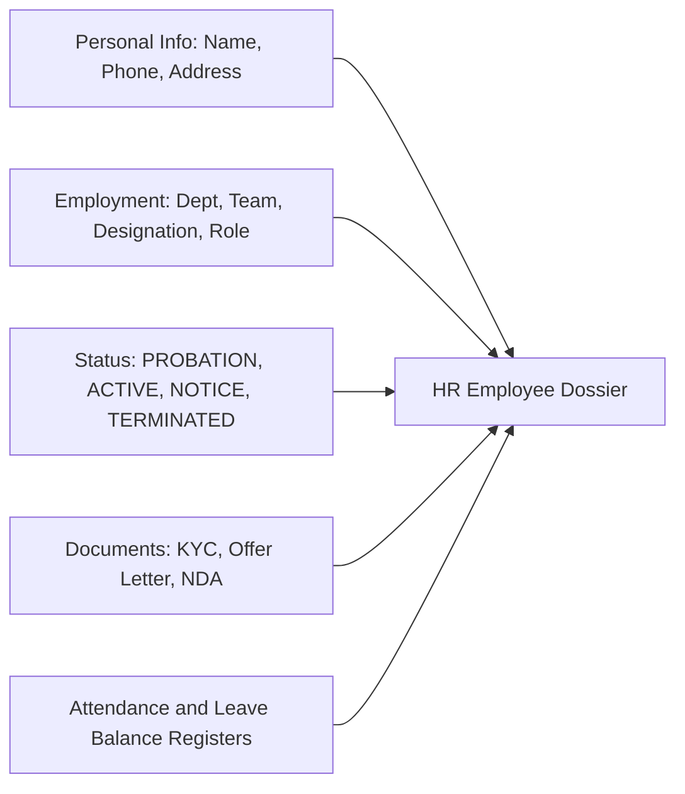

# HR Operations and Corporate Staff Directory

The **HR Operations & Corporate Staff Directory** is the single source of truth for employee employment records across Amuwa Corporation. It tracks corporate titles, departmental reporting lines, employment statuses, and automated legal document generation.

---

## Directory Schema and Employee Lifecycle

Every staff record maintained in the HR directory contains:

- **Corporate Identifiers:** Full legal name, official work email, primary phone, and emergency contact details.
- **Organizational Alignment:** Department assignment, operational team squad, official corporate designation, and reporting manager.
- **Employment Status:**
  - `PROBATION`: Initial review period (typically 3–6 months).
  - `ACTIVE`: Confirmed permanent employee.
  - `NOTICE_PERIOD`: Active resignation serving transition handovers.
  - `TERMINATED / INACTIVE`: Concluded employment with disabled portal access.
- **Joining & Tenancy:** Date of joining (DOJ), official contract tier, and performance milestones.

---

## Step-by-Step HR Directory Procedures

### 1. Navigating the Corporate Directory

1. Sign in with authorized HR credentials.
2. Open the **HR Department Panel**.
3. Select the **Employee Directory** tab.
4. Search by employee name, designation, or department filter to review active rosters.

---

### 2. Updating Employee Profiles

1. Click on an employee card to open the **Staff Profile Modal**.
2. HR can update:
   - **Designation / Job Title:** Reflecting internal promotions.
   - **Department / Team Transfers:** Realigning staff between squads.
   - **Emergency Contact & Address:** Keeping compliance files up to date.
3. Click **Save Profile Updates**.

---

### 3. Offer Letter Generation (one template per designation)

1. In the HR panel, open **HR & Operations > Offer Letter Generation** (or press **Generate Offer** on the dashboard).
2. In **Select Employee Designation / Offer Letter Template**, choose the designation: Technical Support, Customer Support, Business Development Executive, Sales Executive or AI Developer (and any designation added later). That designation's own offer letter loads, with its own fields.
3. Choose the employee. Their name, department, joining date and monthly salary are filled in from the CRM ("from the CRM"); the other fields start with the values of the designation's sample letter. Change anything that needs changing (Customer Support asks for the title, Business Development Executive for the reference number).
4. Check the **Live preview** on the right: it is the finished PDF, on the designation's letterhead, and updates a moment after each change.
5. Press **Generate Offer Letter** to store it on the employee's record, then **Download as PDF**. **Regenerate Document** stores a new copy; earlier letters are kept and never change.
6. **Templates by designation** shows each designation's template, its versions and the letters issued. The Super Admin and the HR Admin Head upload a designation's sample and letterhead, change its wording and fields, and save a new version (new letters use it; issued letters stay as they were).
