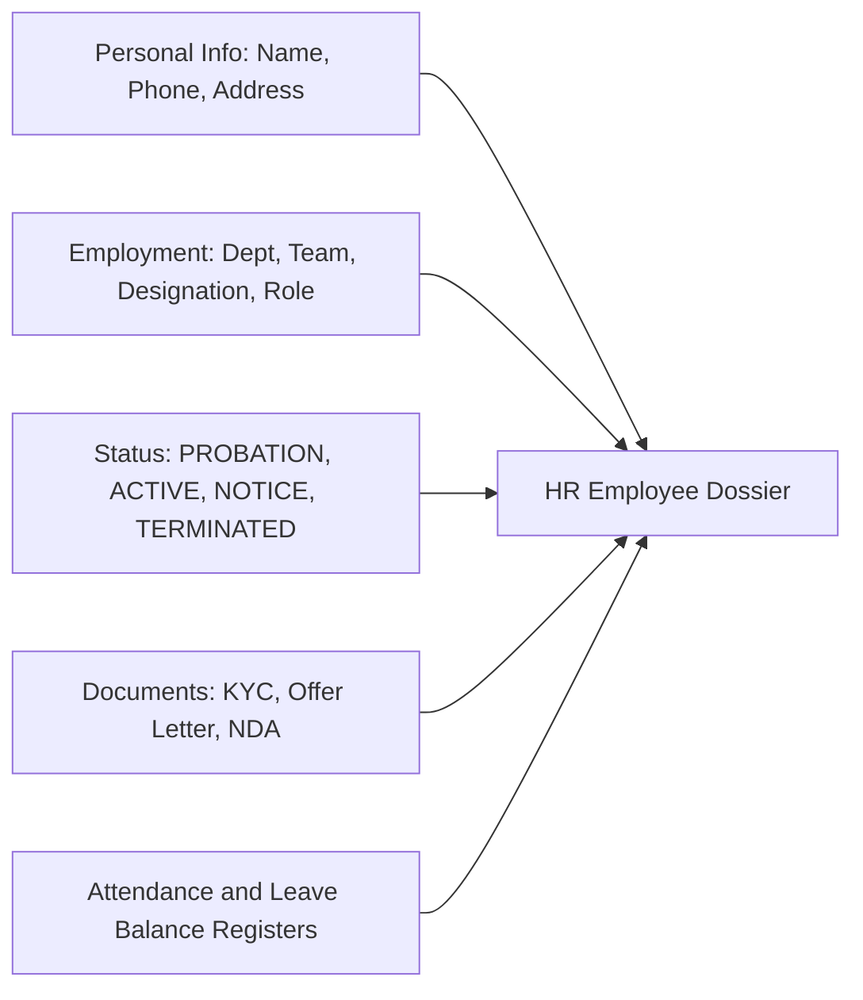

# HR Operations and Corporate Staff Directory

The **HR Operations & Corporate Staff Directory** is the single source of truth for employee employment records across Amuwa Corporation. It tracks corporate titles, departmental reporting lines, employment statuses, and automated legal document generation.

---

## Directory Schema and Employee Lifecycle

Every staff record maintained in the HR directory contains:

- **Corporate Identifiers:** Full legal name, official work email, primary phone, and emergency contact details.
- **Organizational Alignment:** Department assignment, operational team squad, official corporate designation, and reporting manager.
- **Employment Status:**
  - `PROBATION`: Initial review period (typically 3–6 months).
  - `ACTIVE`: Confirmed permanent employee.
  - `NOTICE_PERIOD`: Active resignation serving transition handovers.
  - `TERMINATED / INACTIVE`: Concluded employment with disabled portal access.
- **Joining & Tenancy:** Date of joining (DOJ), official contract tier, and performance milestones.

---

## Step-by-Step HR Directory Procedures

### 1. Navigating the Corporate Directory

1. Sign in with authorized HR credentials.
2. Open the **HR Department Panel**.
3. Select the **Employee Directory** tab.
4. Search by employee name, designation, or department filter to review active rosters.

---

### 2. Updating Employee Profiles

1. Click on an employee card to open the **Staff Profile Modal**.
2. HR can update:
   - **Designation / Job Title:** Reflecting internal promotions.
   - **Department / Team Transfers:** Realigning staff between squads.
   - **Emergency Contact & Address:** Keeping compliance files up to date.
3. Click **Save Profile Updates**.

---

### 3. Automated Offer Letter Generation

The HR workspace features an integrated **Legal Document Automation Engine**:

1. In the HR panel, open the **Offer Letters & Agreements** sub-tab.
2. Click **Generate Offer Letter**.
3. In the generator modal, input parameters:
   - Candidate Name and Contact Information.
   - Position / Designation and Department.
   - Annual CTC, Monthly Base Salary, and Allowances.
   - Date of Joining and Probation Duration.
4. Click **Preview Automated Letter**.
5. The system renders the standardized corporate letterhead including statutory clauses and sign-off blocks.
6. Export as an official PDF or dispatch directly to the candidate's email.
