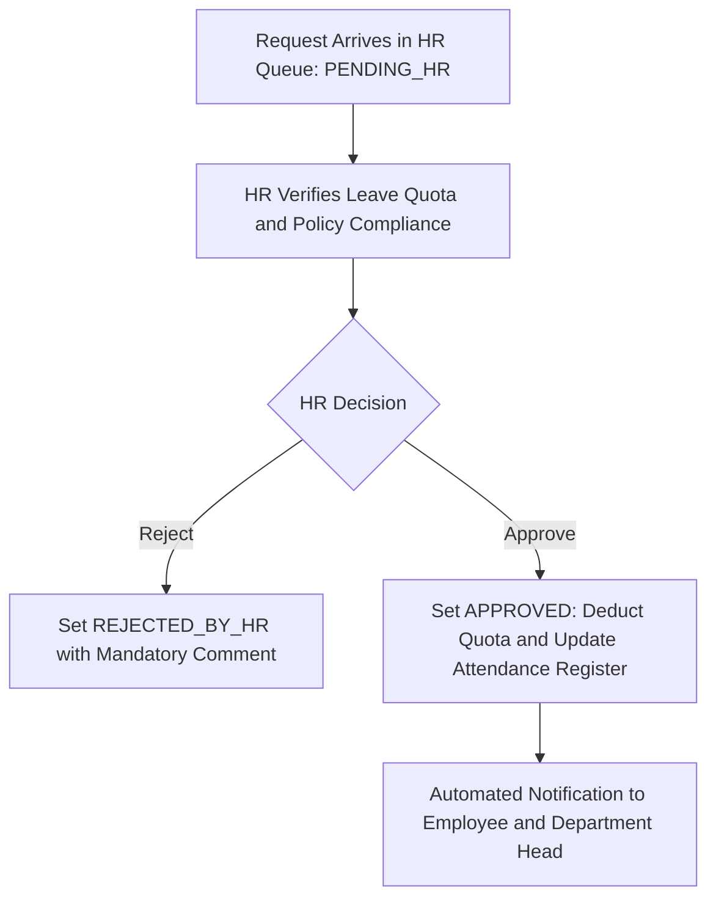

# Final Leave Approvals and Quota Management

In the Amuwa corporate governance framework, all employee leave requests must complete a **two-tier authorization cycle**. Once the applicant's Department Head approves the operational feasibility (Stage 1: `PENDING_DEPARTMENT_HEAD` $\to$ `PENDING_HR`), the request moves to Human Resources for final statutory review and quota balance deduction.

---

## The HR Signoff Workflow

---

## Prerequisites

- You must be logged in as an authorized **HR Manager** (`role === 'hr'`).
- The leave request must have already been authorized by the applicant's Department Head (`status === 'PENDING_HR'`).
- The employee must have active employment standing in the staff directory.

---

## Step-by-Step HR Approval Procedure

### 1. Accessing the Pending HR Approvals Queue

1. Open the **HR Department Panel** (`/departments/hr`).
2. Select the **Leave Approvals** tab.
3. The queue displays all applications awaiting final signoff with the badge **Pending HR Approval** (`PENDING_HR`).

---

### 2. Auditing the Leave Application

1. Click on the application row to expand the full audit card:
   - **Department Head Authorization:** Confirm that the Department Head has approved and read any operational notes they recorded.
   - **Leave Classification:** Verify leave type: Casual Leave (CL), Sick Leave (SL), Earned Leave (EL), or Leave Without Pay (LWP).
   - **Leave Balance Audit:** Review the employee's current accrued days vs remaining days.
   - **Consecutive Days & Medical Documentation:** For sick leaves exceeding 3 consecutive business days, verify that the employee has uploaded an authorized medical certificate.

---

### 3. Granting Final Approval

1. If the request complies with company leave policies and quota allocations:
2. Click the green **Authorize & Grant Leave** button.
3. The CRM executes the final leave workflow:
   - Sets `status = 'APPROVED'`.
   - Records the `hr_approved_at` timestamp and HR reviewer ID.
   - Automatically deducts the requested day(s) or half-day fractions from the employee's active leave quota.
   - Marks the target dates as **Approved Leave** on the daily attendance register so the employee is not marked absent or penalized for missing biometric punches.
   - Dispatches a real-time confirmation notification to both the employee and their Department Head.

---

### 4. Rejecting the Request at the HR Stage

1. If the employee has exhausted their annual quota, failed to submit required medical proof, or violated statutory leave policies:
2. Click the red **Reject Application** button.
3. In the rejection modal, enter a mandatory policy explanation (e.g., *"Casual leave quota exhausted for current calendar quarter; please apply as Leave Without Pay (LWP) if needed"*).
4. Click **Confirm Rejection**.
5. The status transitions to **Rejected by HR** (`REJECTED_BY_HR`), and an alert containing your notes is sent to the employee.
