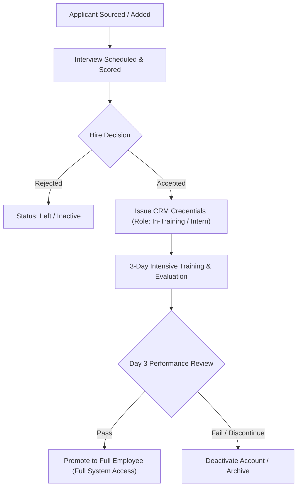

The Human Resources module in Amuwa AI CRM provides an end-to-end talent acquisition and onboarding engine. It bridges initial candidate sourcing, interview evaluations, administrative credential issuance, and the mandatory **3-Day Training & Evaluation Period** before candidates are confirmed into permanent roles.

---

## The Talent Lifecycle in Amuwa CRM

---

## Prerequisites

- You must be logged in as an **HR Manager** (`role === 'hr'`) or **Super Admin**.
- Target candidates must have submitted a resume, contact information, and desired department designation (e.g., Sales Telecaller, Business Associate, Technical Support, or Creative Designer).

---

## Step-by-Step Procedure

### 1. Navigating to the HR Recruitment Workspace

1. Open your CRM dashboard and click **HR & People** in the primary navigation.
2. Select the **Directory & Staff** view. Notice the five tab filters across the top:
   - **All Staff:** Complete corporate directory.
   - **Full Employees:** Confirmed permanent staff with active departmental responsibilities.
   - **In-Training / Interns:** Candidates currently completing their 3-day training or internship trials.
   - **Left / Inactive:** Former personnel or candidates who did not pass onboarding.
   - **Pending Approval:** Self-registered staff accounts awaiting HR identity verification and departmental assignment.

---

### 2. Candidate Onboarding and Account Provisioning

When a new recruit joins the organization for the 3-day training cohort:

1. Click **+ Add Staff Member** (or open the **Pending Approval** tab if the recruit self-registered at `/auth`).
2. Fill out candidate details:
   - **Full Name:** Legal candidate name.
   - **Official Email:** Work email address.
   - **Contact Number:** Primary 10-digit mobile number.
   - **Assigned Department:** (e.g., *Wabastore*, *D Talk*, *Accounts*, *Design Studio*).
   - **Role:** Select the starting position (typically `Telecaller`, `Sales Associate`, `Support Member`, or `Intern`).
   - **Initial Status:** Set to **In-Training / Intern**.
3. Click **Save & Send Credentials**. The CRM generates a welcome email with their initial login instructions.

---

### 3. Monitoring the 3-Day Training Period

During the 3-day evaluation window:

1. Under the **In-Training / Interns** tab, click the candidate's name to open their profile.
2. Monitor daily milestones:
   - **Day 1: Platform & Script Mastery:** Product knowledge quizzes, call scripts, and simulated customer demos.
   - **Day 2: Live Pipeline Shadowing:** Pairing with senior Business Associates or Team Leads; monitoring test calls in the Telecaller workspace.
   - **Day 3: Practical Assessment:** Handling 10 live simulated lead dispositions or completing 3 mock document verifications.
3. Check the candidate's punctuality in the **Attendance Register** to verify synchronized logins (`rmLoginAt`) against physical biometric scans.

---

### 4. Promotion to Full Employee or Account Offboarding

At the end of Day 3:

1. Open the candidate's profile card in HR.
2. If the Department Head and Trainer provide positive feedback:
   - Click **Promote to Full Employee**.
   - Select their permanent designation and confirm their lead allocation quotas.
   - The user transitions to the **Full Employees** directory with permanent permissions.
3. If the candidate discontinues or fails evaluation benchmarks:
   - Click **Revoke Access / Mark Inactive**.
   - Enter a brief closure reason (e.g., *"Did not complete Day 3 assessment"*).
   - Account credentials are immediately invalidated to maintain CRM security.
