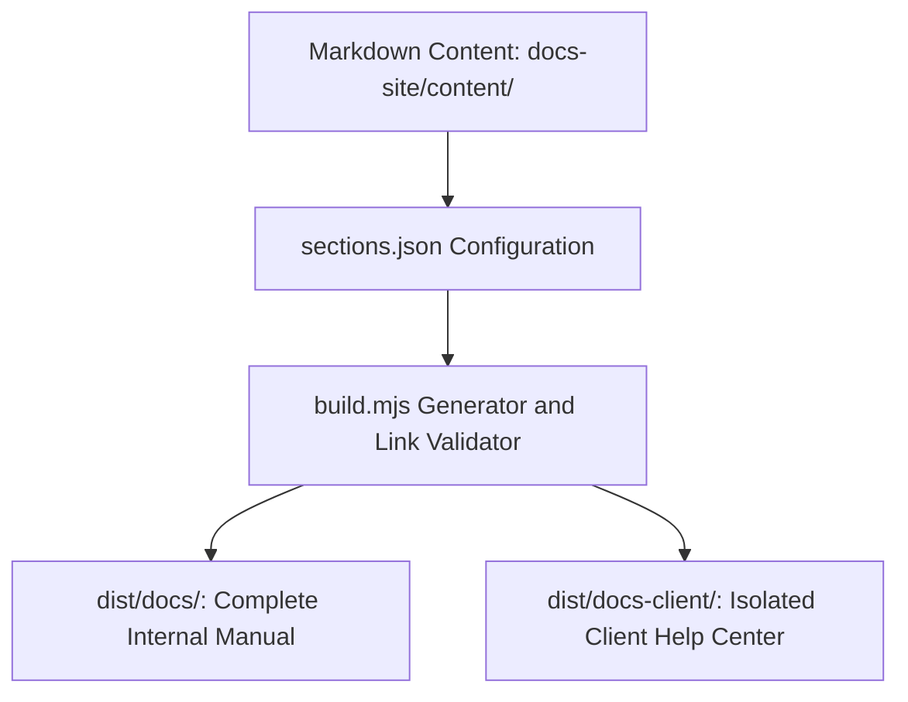

# Documentation Website Maintenance and Contributor Guide

The Amuwa AI CRM user documentation website is designed to evolve alongside the CRM platform. Built with a fast, zero-dependency static site generator (`docs-site/build.mjs`), it ensures that both internal employee manuals and external client help portals remain accurate, validated, and accessible.

---

## Documentation Architecture



- **Content Directory:** `docs-site/content/<section-id>/<article-slug>.md`
- **Sections Definition:** `docs-site/sections.json`
- **Builder Engine:** `docs-site/build.mjs`
- **Styles & Themes:** `docs-site/assets/docs.css` (styled with Manrope, JetBrains Mono, and CRM corporate theme tokens).

---

## Article Frontmatter Schema

Every documentation article must begin with YAML frontmatter conforming to the following specification:

```yaml
---
title: How to Perform a Specific Task
summary: A clear 1-2 sentence description explaining what the user accomplishes.
audience: internal # Options: internal | client | both
roles:             # Relevant role tags
  - Sales Team Member
  - Technical Consultant
related:           # Internal links to related procedures
  - /sales/my-leads-overview
  - /sales/sending-to-accounts
---
```

### Frontmatter Fields

| Property | Type | Description |
| :--- | :--- | :--- |
| `title` | String | Specific, task-oriented article title. Avoid vague headers. |
| `summary` | String | Concise summary displayed in search previews and section indexes. |
| `audience` | Enum | `internal` (employee portal only), `client` (client portal only), or `both`. |
| `home` | Enum | Optional. Set `home: client` on the root landing page for client documentation. |
| `roles` | List | Operational roles permitted to perform this procedure. |
| `related` | List | Relative links (`/section/slug`) to related guides. Validated at build time. |

---

## Build Commands and Scripts

All documentation scripts are integrated into `package.json`:

### 1. Build Full Internal Documentation
```bash
npm run docs:build
```
Builds the complete internal knowledge base to `dist/docs/`. Scans every article, computes headings, builds the full-text search index, and enforces zero-tolerance link validation.

---

### 2. Build Client Documentation Portal
```bash
npm run docs:build-client
```
Builds the customer-facing documentation portal to `dist/docs-client/`. Strictly includes only articles marked `audience: client` or `audience: both`. Completely strips internal employee procedures, administrative tools, and confidential queues.

---

### 3. Verify Links and Content
```bash
npm run docs:check
```
Runs the strict link and anchor validator. If any relative link, anchor tag, or related article reference does not resolve to an existing file, the build exits with an error code and reports the exact broken URL.

---

### 4. Local Preview Server
```bash
npm run docs:serve
```
Starts a lightweight local HTTP server previewing the documentation at `http://localhost:3000`.

---

## Editorial Guidelines and Accuracy Rules

1. **Verify UI Labels Against Active Code:** Every button label (e.g., *Send to Accounts*, *Pass to Team Lead*, *Confirm & Verify Payment*) must match the exact string rendered in `src/`.
2. **Never Fabricate Unimplemented Features:** If a planned capability is mentioned in legacy roadmaps but does not exist in active code, do not document it as available.
3. **No Credential Exposure:** Never include production passwords, live API tokens, or real customer phone numbers in example code or walkthroughs.
4. **Isolate Client Documentation:** Never allow internal employee procedures, database details, or supervisory workflows to leak into client-facing articles.
