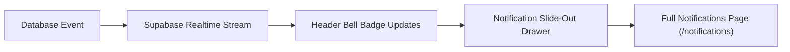

# Notification Center and Real-Time Alerts

Amuwa AI CRM features a real-time event notification engine powered by Supabase Realtime. Whether a customer is sent to Accounts, a document is rejected by a Technical Consultant, an SLA clock reaches escalation threshold, or a leave request is approved, employees receive instant notifications without needing to refresh their browser.

---

## Accessing the Notification Center

### 1. The Header Notification Bell
- Located at the top right of the application header.
- Displays a red counter badge indicating the number of unread alerts.
- Animates gently when a new alert is received in real time.

---

### 2. The Notification Drawer
- Clicking the bell icon opens the slide-out **Notification Drawer**.
- Lists the most recent 10 notifications with relative timestamps (e.g., *"2 minutes ago"*).
- Each notification includes an icon indicating the event category and a bold summary line.

---

### 3. The Dedicated Notifications Page
- Click **View All Notifications** at the bottom of the drawer to open `/notifications`.
- Filter alerts by date range, priority level, or read/unread state.

---

## Notification Priority Levels

| Priority | Tone | Typical Events | Behavior |
| :--- | :--- | :--- | :--- |
| **URGENT** | Red | SLA breach escalation, customer returned for re-verification, payment reversal. | Persistent banner alert; high-priority sound. |
| **HIGH** | Orange | Customer awaiting payment confirmation, handover assigned to your squad. | Highlighted card with action button. |
| **NORMAL** | Blue | Daily attendance punch logged, conversation note added, task updated. | Standard feed item. |
| **LOW** | Slate | System maintenance announcements, non-urgent status changes. | Informational summary. |

---

## Interactive Notification Actions

Notifications in Amuwa AI CRM are **deep-linked**:

1. **Direct Navigation:** Clicking any notification item automatically routes you to the relevant record (e.g., clicking *"Customer Kuber Logistics returned by TC"* opens that specific customer dossier).
2. **Mark as Read:** Click the small checkmark icon next to an individual alert to dismiss the unread badge.
3. **Mark All as Read:** Click the **Mark All as Read** button at the top of the drawer to clear all unread counters simultaneously.
4. **Clear History:** Cleans up dismissed notifications from your active list while preserving immutable audit logs in the database.
