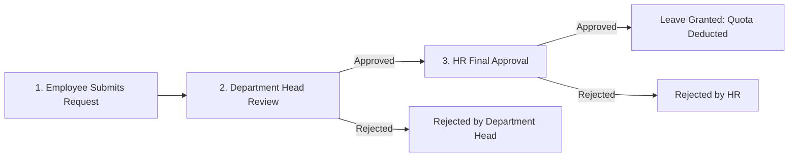

All corporate employees in Amuwa AI CRM submit time-off and leave applications through the integrated **Leave Center**. Applications flow through a transparent, two-tier authorization process to ensure operational coverage and accurate payroll attendance records.

---

## Two-Tier Approval Journey

1. **Stage 1 (Department Head):** Evaluates squad coverage, active client deadlines, and operational impact.
2. **Stage 2 (Human Resources):** Validates company leave balances, statutory rules, and adjusts the payroll attendance register.

---

## Leave Categories and Quotas

| Leave Type | Code | Purpose | Documentation Required |
| :--- | :--- | :--- | :--- |
| **Casual Leave** | `CASUAL` | Urgent personal business, family events. | None |
| **Sick Leave** | `SICK` | Personal illness or medical appointments. | Medical certificate required if more than 3 consecutive days |
| **Earned Leave** | `EARNED` | Planned vacations and extended breaks. | Apply at least 7 days in advance |
| **Leave Without Pay** | `UNPAID` | Unpaid time off when quotas are exhausted. | Prior administrative approval |

---

## Step-by-Step Procedure: Submitting a Request

### 1. Open the Leave Request Dialog

1. In the top navigation header, locate your profile avatar or the **Leave** button.
2. Click **Apply for Leave** on your leave page.
3. The **Request Leave Dialog** opens.

---

### 2. Configure Leave Parameters

1. **Leave Type:** Select `Casual Leave`, `Sick Leave`, `Earned Leave`, or `Unpaid Leave`.
2. **Date Range:**
   - Select the **Start Date** and **End Date**.
   - If applying for a single day, set both fields to the same date.
3. **Day Duration:**
   - **Full Day:** Covers entire working hours.
   - **Half Day (First Half / Morning):** Shift ends at 1:30 PM.
   - **Half Day (Second Half / Afternoon):** Shift begins at 2:00 PM.
4. **Reason for Leave:**
   - Enter a clear, professional reason (minimum 10 characters).
   - E.g., *"Medical appointment and scheduled dental surgery."*

---

### 3. Check Remaining Balance and Submit

1. Review the **Current Balance Summary** card displayed in the dialog:
   - Accrued Days vs Days Remaining.
   - Calculated days for this application (e.g., `0.5 days` for half-day).
2. Click **Submit Leave Request**.
3. The application is created in status **Pending Department Head Approval** (`PENDING_DEPARTMENT_HEAD`).

---

## Tracking Application Status

You can check the status of your submitted requests at any time under **My Leave Applications**:

- **Pending Department Head Approval (`PENDING_DEPARTMENT_HEAD`):** Under initial operational review.
- **Pending HR Approval (`PENDING_HR`):** Approved by your Department Head; awaiting HR statutory confirmation.
- **Approved (`APPROVED`):** Officially granted; your daily attendance register automatically reflects your approved absence.
- **Rejected (`REJECTED_BY_DEPARTMENT_HEAD` or `REJECTED_BY_HR`):** Application declined. Click the card to view the reviewer's mandatory explanation note.
