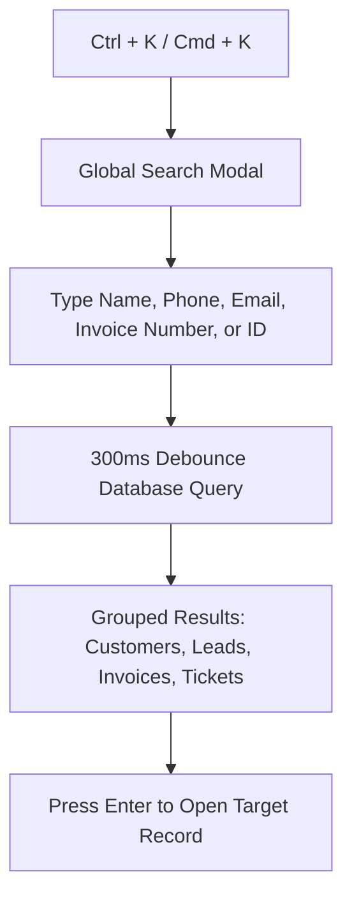

# Advanced Searching and Filtering Across the CRM

Finding leads, customer dossiers, invoices, and support tickets swiftly is critical to daily productivity. Amuwa AI CRM provides a high-performance, debounced search infrastructure equipped with global keyboard shortcuts and granular multi-faceted filters.

---

## Global Quick-Search (`Ctrl + K`)

Pressing `Ctrl + K` (or `Cmd + K` on macOS) anywhere within the internal application opens the **Global Command & Search Palette**:

- **Query Flexibility:** You can search across multiple fields simultaneously:
  - Customer Business Name (e.g., *"Kuber Logistics"*).
  - Contact Person (e.g., *"Rajesh Sharma"*).
  - Phone Number (full digits or last 4 digits).
  - Corporate Email Address.
  - Invoice Number (e.g., `AMW-INV-2026-0042`).
  - Meta WABA ID (15–18 digit numeric ID).
- **Keyboard Navigation:** Use the `Up` and `Down` arrow keys to highlight results, and press `Enter` to jump immediately to the selected record. Press `Esc` to close.

---

## Queue and Table Filtering

Within specific departmental queues (such as My Leads, Accounts Payment Queue, or Technical Onboarding), tables feature contextual filter toolbars:

### 1. Stage and Status Tabs
- **Sales Panel:** Rapidly toggle between **1 Leads**, **2 Potential Customers**, and **3 Customer Onboarding**.
- **Accounts Panel:** Switch between **To Verify**, **Part Payments**, and **All Invoices**.
- **Technical Consultant:** Filter by **Review pending**, **Needs attention**, **Authorized**, and **Waiting for sales team**.

---

### 2. Multi-Criteria Filters
- **Service Offering Filter:** Filter records by specific purchased service codes (e.g., show only clients with `WA_API_PRO`).
- **Follow-Up Schedule Filter:** Isolate leads requiring attention today, overdue follow-ups, or leads scheduled for next week.
- **Payment Standing:** Filter customer accounts by `PAID`, `PARTIAL`, `PENDING`, or `UNPAID`.
- **Ownership Filter (for Managers):** Department Heads and Team Leads can filter queues to display either the entire squad or specific individual team members.

---

## Sorting Best Practices

Every queue provides a quick-sort dropdown:
- **Newest First (Default):** Orders by `created_at DESC` to prioritize freshly ingested leads and newly received handovers.
- **Oldest First:** Useful for auditing aging tickets or overdue onboarding tasks.
- **Alphabetical (A–Z):** Sorts by business company name for quick directory browsing.
- **Follow-Up Date:** Sorts by nearest scheduled conversation callback timestamp.
