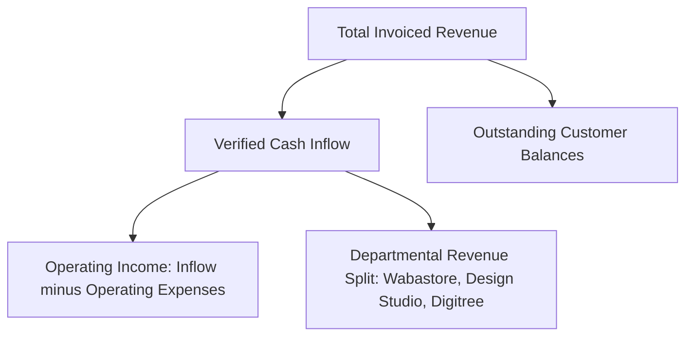

# Corporate Financial Intelligence and Business Oversight

As the enterprise holding entity, Amuwa Corporation requires consolidated visibility into financial operations across all autonomous business divisions. The **Business Oversight & Corporate Intelligence** module provides Super Admins with unified access to global income ledgers, invoice status distributions, and revenue attribution metrics.

---

## Executive Financial KPI Dashboard

When accessing corporate financial oversight (the company overview and **Business Reports**), Super Admins review enterprise-wide metrics:

- **Gross Invoiced Volume:** Total face value of all invoices issued across the enterprise.
- **Verified Collections:** Actual cash received and reconciled in bank accounts (`status === 'VERIFIED'`).
- **Outstanding Accounts Receivable:** Cumulative unpaid invoice amounts currently in follow-up across Sales and Accounts.
- **Departmental Revenue Breakdown:** Proportional income split across Wabastore, Amuwa Design Studio, Digitree Infotech, and D Talk.
- **Operating Expense Ledger:** Corporate overhead, vendor disbursements, server hosting, and payroll expenditures.

---

## Auditing and Resolving Unclassified Invoices

Historical transactions or automated gateway payments occasionally lack explicit department or salesperson tags. Super Admins possess tools to audit and reclassify these records:

### 1. Identifying Unclassified Invoices

1. Open the **Financial Audit & Ledger** view.
2. In the attribution filter, select **Unclassified / Missing Attribution**.
3. The queue lists invoices where `department_id` or `attributed_to` is null.

---

### 2. Investigating Originating Leads and Services

1. Click on an unclassified invoice to inspect line items, customer details, and payment gateway references.
2. Cross-reference the customer's initial lead source and purchased service codes (e.g., a `WA_*` service originated with Wabastore).

---

### 3. Applying Official Business Attribution

1. In the **Attribution Toolbar**, select:
   - **Originating Department:** Select the correct division.
   - **Business Channel:** Classify as **Sales** (new acquisition) or **Support** (retention/upsell).
   - **Credited Staff Member:** Assign the responsible salesperson or relationship manager.
2. Click **Apply Attribution**.
3. The CRM updates the ledger and recalculates departmental revenue reports automatically.

---

## Revenue Reconciliations and Bank Audits

- **Zero-Tolerance Reconciliation:** Only transactions marked `VERIFIED` in `customer_payments` count as corporate income. Unverified payments or bounced drafts are strictly segregated.
- **Audit Trails:** Any managerial reversal or manual balance adjustment generates an immutable log entry containing the administrator's ID, timestamp, and justification reason.
