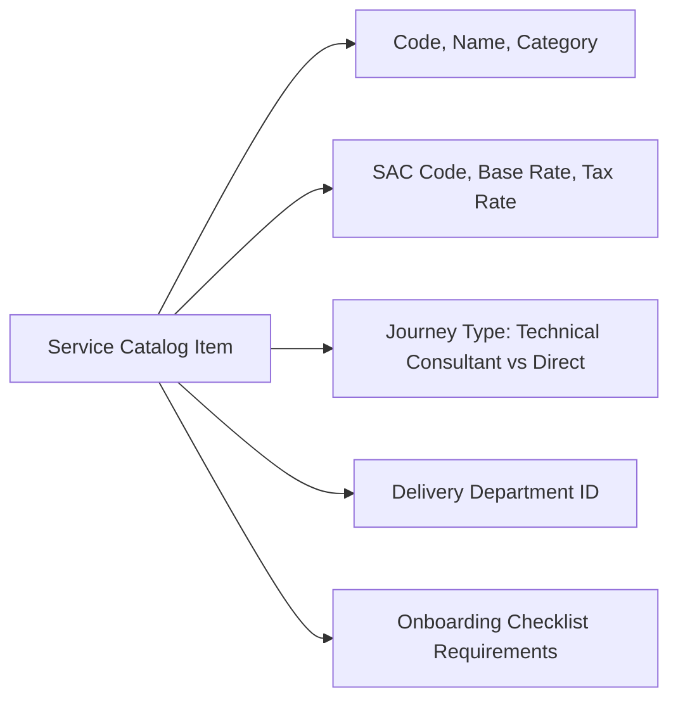

# Service Catalog and Journey Routing Administration

Every product, software tier, and creative deliverable sold across Amuwa Corporation is defined in the centralized **Service Catalog**.

Beyond names and base pricing, each catalog item dictates **how the customer journey progresses** through the CRM-specifically whether the order mandates Technical Consultant verification or follows a direct fulfillment route.

---

## Service Catalog Structure and Attributes

Each catalog offering incorporates the following schema:



- **Service Code:** Unique machine identifier (e.g., `WA_API_PRO`, `DS_BRAND_IDENTITY`, `AI_AGENT_FLOW`).
- **Display Name & Category:** Customer-facing title and classification (e.g., *Meta Official WhatsApp Business API & Blue Tick* under *WhatsApp Marketing*).
- **Financial & Tax Meta:** Standard SAC Code (e.g., `998314` for IT & Software Services) and base unit pricing.
- **Journey Configuration:**
  - `requiresTechnicalConsultant`: Boolean flag determining workflow.
  - `deliveryDepartmentId`: Foreign key mapping to the responsible delivery division (`wabastore`, `designstudio`, `digitree`, etc.).
- **Onboarding Checklist Templates:** Required documents (e.g., PAN, GST, Business Registration) or configuration fields (e.g., WABA ID, Website URL).

---

## Configuring Service Journey Types

Super Admins configure service journeys via the Service Catalog administration endpoint:

```http
POST /api/service-catalog/:code/journey
Content-Type: application/json

{
  "requiresTechnicalConsultant": true,
  "deliveryDepartmentId": "wabastore"
}
```

### 1. Technical Journey (`requiresTechnicalConsultant: true`)
- **Use Cases:** Meta WhatsApp Business API, green badge/blue tick verifications, complex conversational bot integrations.
- **Workflow:** Requires Technical Consultant to review and authorize business documents, collect WABA IDs, trigger automated client onboarding messaging, and provision client portal logins before transfer to Department Head.

---

### 2. Direct Journey (`requiresTechnicalConsultant: false`)
- **Use Cases:** Amuwa Design Studio creative kits, brand identities, standard web development, standalone social media marketing.
- **Workflow:** Skips Technical Consultant entirely. Accounts provisions the client portal login during payment confirmation; Sales verifies creative briefs; and the order routes directly to the delivery department.

---

## Best Practices for Catalog Maintenance

1. **SAC Code Accuracy:** Always assign valid 6-digit SAC codes (typically `998314` or `998319` for digital and IT solutions) to ensure compliant GST invoice generation.
2. **Never Delete Active Service Codes:** If an offering is retired, mark it as `INACTIVE` rather than deleting the database row. Deleting active codes corrupts historical invoices and revenue reports.
3. **Multi-Service Orders:** If a customer purchases both a Technical service and a Direct service in a single order, the CRM automatically assigns the **MIXED journey**, prioritizing Technical Consultant review before splitting deliverables to respective departments.
