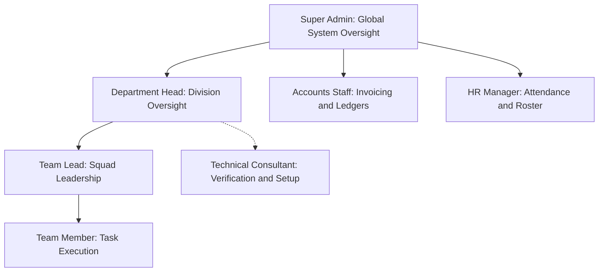

# Staff and Role Administration Manual

Super Admins hold centralized authority over the corporate workforce directory in Amuwa AI CRM. This includes creating authenticated employee accounts, mapping users to departments and operational squads, assigning hierarchical roles, and provisioning specialized privileges such as Technical Consultant designations.

---

## Role Hierarchy and Privilege Boundaries

The CRM implements a strict role inheritance hierarchy:

| System Role | Scope | Creatable By | Permitted Assignments |
| :--- | :--- | :--- | :--- |
| **Super Admin** (`SUPER_ADMIN`) | Global enterprise access across all departments. | System deployment script / Database | All roles |
| **Department Head** (`DEPARTMENT_HEAD`) | Complete oversight of assigned department division. | Super Admin | Team Leads, Team Members within dept |
| **Team Lead** (`TEAM_HEAD`) | Squad management, lead distributions, and delivery assignments. | Super Admin, Department Head | Team Members within squad |
| **Team Member** (`TEAM_MEMBER`) | Operational execution (Sales, Support, or Delivery). | Super Admin, Department Head, Team Lead | Task execution only |
| **Technical Consultant** | Specialized Support Team Member with document authorization powers. | Super Admin, Department Head | Technical verification, client login provisioning |
| **Accounts Staff** (`accounts-staff`) | Invoicing, payments ledger, agreements, financial reporting. | Super Admin | Accounting functions only |
| **HR Staff** (`hr`) | Staff directory, biometric attendance, final leave approvals. | Super Admin | Human resources operations |

---

## Step-by-Step Procedure: Provisioning a New Employee

### 1. Open the Staff Management Panel

1. In the Super Admin navigation, select **Staff Directory** (or open the **Staff Management** tab in any Department panel).
2. Click the blue **Add Team Member** button.

---

### 2. Enter Identity and Account Credentials

1. Fill in the mandatory identity fields:
   - **Full Name:** Official employee name (e.g., *"Priya Nair"*).
   - **Work Email:** Unique corporate email address used for sign-in (e.g., `priya.nair@amuwa.com`).
   - **Initial Password:** Secure temporary password (minimum 8 characters).
   - **Job Position / Designation:** Corporate title (e.g., *"Senior WhatsApp Solutions Engineer"*).

---

### 3. Assign Department, Team, and Role

1. **Select Role:** Choose from `DEPARTMENT_HEAD`, `TEAM_HEAD`, `TEAM_MEMBER`, `accounts-staff`, or `hr`.
2. **Assign Department:** Select the target business entity (e.g., *Wabastore*).
3. **Assign Team / Squad:** If assigning a Team Lead or Team Member, select the specific squad (e.g., *Enterprise Sales Squad 1*).
4. **Technical Consultant Toggle:** If the member belongs to a Support team and will verify onboarding customer documents and WABA IDs, toggle the **Technical Consultant** checkbox (`technicalConsultant: true`).

---

### 4. Save and Dispatch

1. Click **Create Employee Account**.
2. The CRM executes atomic provisioning:
   - Registers user in Supabase Authentication (`auth.users`).
   - Creates corresponding employee record in `profiles`.
   - Links departmental permissions and audit metadata.
3. The member appears immediately in the active roster.

---

## Modifying Existing Staff Members

- **Promote / Demote:** Super Admins can select an active staff member and adjust their role (e.g., promoting a senior Team Member to Team Lead).
- **Toggle Technical Consultant:** Click **Set Technical Consultant** on a support member card to grant or revoke onboarding verification authority.
- **Deactivate Account:** If an employee departs the company, click **Deactivate Account**. Deactivation instantly invalidates active authentication tokens and terminates concurrent sessions without deleting historical audit logs.
- **Password Reset:** Super Admins can issue a temporary password override if an employee is locked out of their account.
