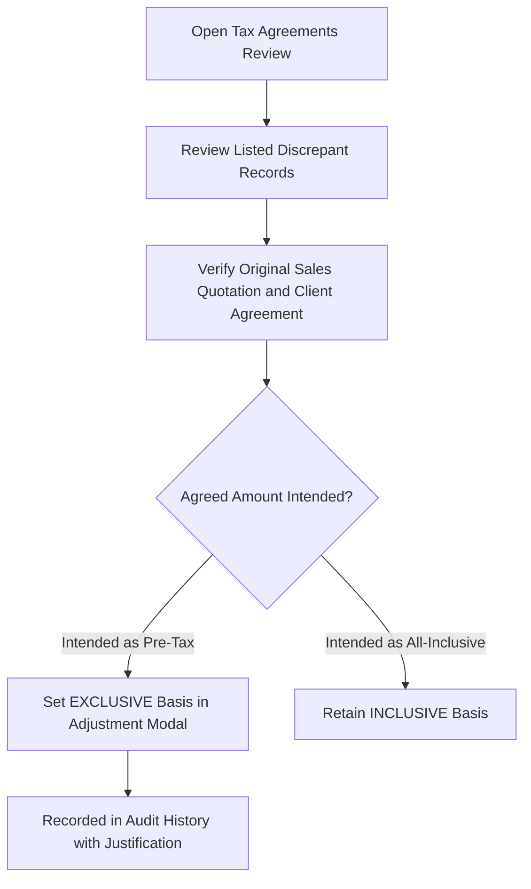

# Tax Agreements Review and Order Basis Audit

Customer deals in Amuwa AI CRM are recorded under one of two tax basis models:

1. **EXCLUSIVE (Default):** The agreed deal amount represents the base taxable service value; standard 18% GST is added on top. (e.g., ₹50,000 deal + ₹9,000 GST = ₹59,000 total payable).
2. **INCLUSIVE:** The agreed deal amount represents the total gross payable figure including 18% GST. (e.g., ₹50,000 gross = ₹42,372.88 taxable + ₹7,627.12 GST).

To maintain legal accounting integrity, **historical agreements created under older billing settings are not automatically rewritten**. Instead, Super Admins and Accounts staff use the **Tax Agreements Review** tool to audit and reconcile customer accounts.

---

## The Agreement Review Tool

The **Tax Agreements Review** interface automatically identifies customer records where:
- The agreement was formed under older system settings.
- The customer has active issued invoices or verified payments.
- Discrepancies exist between quoted sales figures and cumulative invoice totals.

Super Admins can access this review view at `/accounts/agreement-review` (or through the Invoice Builder's *"The agreed amount is before GST"* link).

---

## Reviewing Legacy Agreements

### Step-by-Step Procedure

1. In the Accounts / Super Admin navigation, open **Tax Agreements Review**.
2. The review table displays:
   - Customer and business entity name.
   - Initial Deal Amount recorded by Sales.
   - Current Agreement Tax Basis (`INCLUSIVE` vs `EXCLUSIVE`).
   - Total Invoiced Amount to date.
   - Variance / Discrepancy indicator.

---

### Adjusting Agreement Basis

If sales communications confirm that a client was quoted an exclusive pre-tax price:

1. Click **Adjust Agreement Basis** next to the customer row.
2. In the adjustment modal:
   - **Select Correct Basis:** Choose **EXCLUSIVE (Deal Amount + 18% GST)**.
   - **Mandatory Justification Reason:** State the documented reason (e.g., *"Confirmed against client sales proposal dated Oct 12; deal amount was quoted excluding 18% GST"*).
3. Click **Apply Basis Change**.
4. The system updates the customer record:
   - Saves the updated order tax basis for the customer.
   - Records an immutable audit log entry with your user identity, justification, and timestamp.
   - Does **not** arbitrarily alter existing issued PDFs; all subsequent invoices and balance computations reflect the corrected ceiling.

---

## Compliance and Safeguards

> [!WARNING]
> **No Automatic Mass-Rewrites:**
> The CRM strictly prohibits automated bulk conversions of agreements. Every tax basis change must be manually reviewed, justified with a mandatory reason, and permanently attached to the staff member's audit record.
