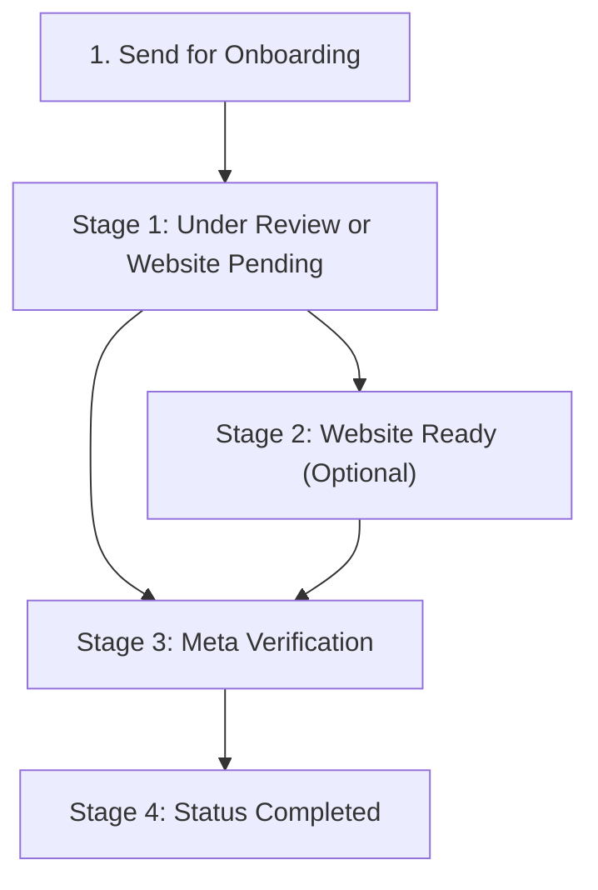

# Onboarding Automations and Client Messaging Pipeline

For services with automated client onboarding communications—such as **Wabastore Official Meta WhatsApp API & Blue Tick**—the CRM features a built-in event-driven messaging engine.

As Technical Consultants verify documents, update website URLs, and create client credentials, the system automatically queues and delivers tailored notifications to the customer across **Email and WhatsApp** in lockstep with their onboarding milestones.

---

## The Customer Emails & WhatsApp Panel

Located on the customer detail workspace, the **Customer emails & WhatsApp** panel displays the live status of all automated communication jobs:

- **Panel Heading:** `Customer emails & WhatsApp`
- **Subtext:** *"Sent automatically at each step of your work. Each step is sent once."*
- **Realtime Integration:** Connected via Supabase Realtime to the `automation_jobs` table; updates dynamically without page reloads.

---

## Onboarding Communication Milestones

The automated messaging engine moves through 4 distinct progressive milestones:

### Stage 1: Under Review or Website Pending
- **Trigger:** Initiated the moment Sales or TC clicks **Send for onboarding**.
- **Customer Outcome:**
  - **With Existing Website:** Receives the *"Documents Received — Under Review"* email and WhatsApp acknowledgment.
  - **No Website:** Receives the *"Mini Website for Your Business"* notification confirming that website setup has begun.

---

### Stage 2: Website Ready (Optional)
- **Trigger:** When the Technical Consultant configures the newly provisioned website URL in the checklist (`WA_WEBSITE_URL`) and clicks **Authorize**.
- **Customer Outcome:** The client receives the *"Your Business Website is Live"* notification with direct preview links.

---

### Stage 3: Meta Verification
- **Trigger:** Fired immediately when **every required document is authorized** by the Technical Consultant.
- **Customer Outcome:** The client receives the *"Meta Business Verification in Progress"* notification, informing them that official Meta API verification takes approximately 2 to 3 weeks and detailing next steps.

---

### Stage 4: Status Completed
- **Trigger:** Fired when the Technical Consultant creates the client portal login in the **Client panel login** card.
- **Customer Outcome:** The client receives the *"Meta Verification Completed & Portal Access"* email and WhatsApp, containing their username, secure password, and direct link to sign in to `/client/login`.

---

## Message Queue Statuses

Each communication item in the panel displays one of six statuses:

| Status Badge | Style | Meaning | Action Needed |
| :--- | :--- | :--- | :--- |
| **Queued** | Slate | Awaiting dispatch worker. | None (auto-processed). |
| **Sending** | Blue | Currently communicating with SMTP / WhatsApp gateway. | None. |
| **Sent** | Emerald | Successfully delivered to client's inbox and phone. | None. |
| **Failed** | Rose | Delivery rejected (e.g., invalid phone or SMTP error). | Review error; use Resend. |
| **Not sent / Skipped** | Amber | Customer opted out or missing channel info. | Verify contact data. |
| **Cancelled** | Muted Slate | Superseded by subsequent stage or cancelled. | Informational only. |

---

## How to Resend Failed Messages

If a client reports not receiving their login credentials or verification notifications:

1. In the **Customer emails & WhatsApp** panel, inspect the failed message row.
2. Verify that the client's email address and WhatsApp contact number are correct.
3. Click the **Resend messages** button at the top-right of the panel.
4. The system resets the message job status to `QUEUED` and re-dispatches the payload through the notification queue.
5. A confirmation notice appears: *"The messages are being sent."*
