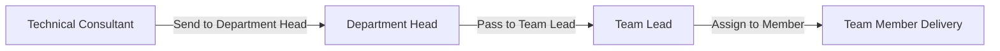

# How to Hand Over a Verified Customer to Department Head

The departmental handover marks the formal completion of the Technical Consultant's verification responsibilities. Once all client documents are verified and the client portal login is provisioned, the customer record is transferred to the responsible **Department Head**, who then routes it to a delivery **Team Lead**.

---

## Handover Prerequisites Checklist

Before the **Send to Department Head** button activates, the CRM verifies the following conditions in real time:

| Condition | Verification Rule | System Error Message If Unmet |
| :--- | :--- | :--- |
| **All Documents Verified** | `itemsVerified >= itemsTotal` | *"All documents must be authorized first."* |
| **No Rejections Outstanding** | `itemsRejected === 0` | *"[N] items marked Not authorized. Resolve or send back."* |
| **Consultant Items Complete** | `consultantItemsDone >= consultantItemsTotal` | *"Consultant items (e.g., WABA ID) must be saved."* |
| **Client Login Exists** | `handoverInfo.clientAccount` is provisioned | *"Client portal login must be created before handover."* |
| **Not Waiting on Sales** | `returnedAt` is `null` | *"Customer is currently with sales for re-verification."* |

If any condition fails, the button remains greyed out, and an amber explanation appears directly below the button.

---

## Step-by-Step Handover Procedure

### 1. Confirm Verification Completeness

1. In the customer detail workspace, review the **Checklist Summary**:
   - Ensure the card status displays the green **Authorized** badge.
   - Confirm that all uploaded files display the green `✓ Authorized` pill.
2. In the right column, verify that the **Client panel login** card displays:
   - `✓ Login created` along with the registered email.

---

### 2. Initiate the Handover Dialog

1. In the upper-right action area, click the emerald-green **Send to Department Head** button.
2. The modal dialog opens:
   - **Dialog Title:** `Send to Department Head`
   - **Description:** *"[Business Name] is verified and its client login is ready. The Department Head passes it to a Team Lead, who assigns it to a Team Member. Your review closes once you send it."*

---

### 3. Record Operational Handover Notes

1. In the **Note for the Department Head (optional)** field, provide relevant delivery context:
   - Note any specific client preferences, communication channels, or target launch deadlines.
   - Highlight any custom deliverables agreed upon during onboarding consultations.
2. Character limit: 1,000 characters.

---

### 4. Confirm and Dispatch

1. Click **Yes, send**.
2. The CRM executes the atomic transition:
   - Sets `handover_stage = 'DEPARTMENT_HEAD'`.
   - Records `to_department_head_at` timestamp.
   - Attaches your note to the customer audit trail.
   - Updates the customer queue counter.

---

## Handover Progression Stages

Following dispatch, the customer detail view replaces action buttons with the persistent **Handover Status Banner**:

1. **With the Department Head (`DEPARTMENT_HEAD`):**
   - The customer appears in the Department Head's **Incoming Handovers** queue.
   - The Department Head reviews the dossier and selects the appropriate operational Team Lead.
2. **With the Team Lead (`TEAM_LEAD`):**
   - The Team Lead allocates specific client tasks to available Team Members.
3. **With the Team Member (`TEAM_MEMBER`):**
   - The assigned engineer or specialist executes setup, API configurations, and campaign launches.

---

## Technical Consultant Scope After Handover

Once the customer is handed over:
- The customer status in the Consultant list displays **Handed over** (`HANDED_OVER` in sky-blue styling).
- The onboarding checklist and client credentials switch to **read-only view**.
- Technical Consultants retain access to **Client Activity Calendar** and **Client Documents Review** to assist support teams if clients upload post-onboarding materials.
