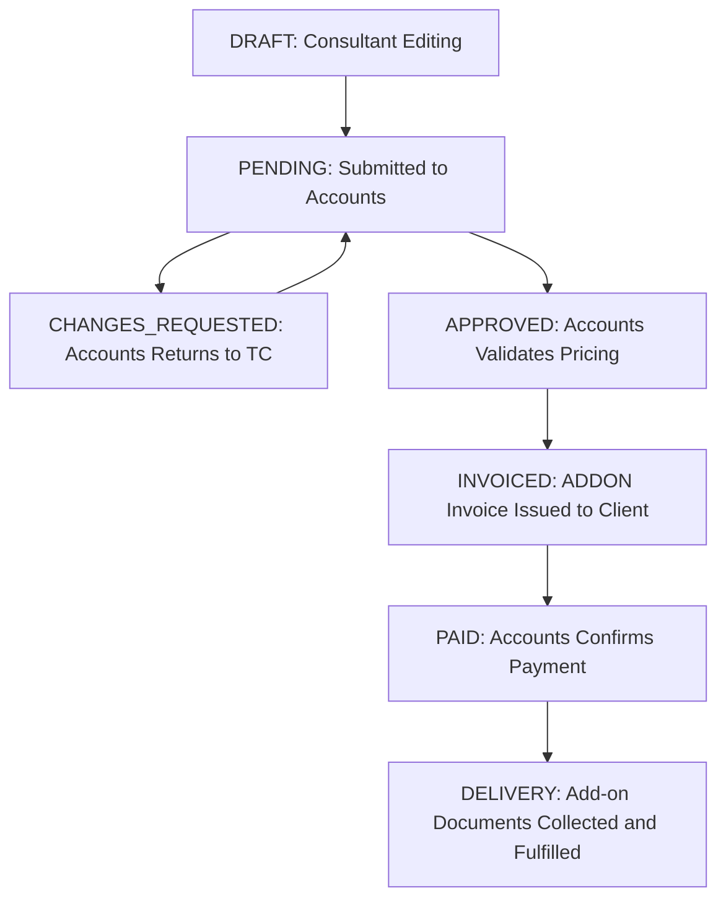

# How to Manage and Submit Add-on Service Requests

During technical onboarding, clients frequently request supplemental capabilities-such as custom chatbot automations, additional WhatsApp Business numbers, catalog design templates, or custom CRM integrations.

The **Add-ons Services** module enables Technical Consultants to draft priced add-on proposals, submit them to Accounts for verification and billing, and collect supplemental onboarding items **without ever blocking core onboarding progress**.

---

## Prerequisites

- You must be logged in as a **Technical Consultant**.
- The customer must have an active onboarding record.
- The requested services must exist in the service catalog (or be configured as custom deliverables).

---

## Navigating to Add-ons Services

1. Open your Technical Consultant dashboard.
2. In the left navigation bar, click **Add-ons Services** (icon with `Briefcase` or `FolderOpen`).
3. The queue displays all customers with active or historical add-on requests, along with a top summary badge showing pending requests.

---

## Step-by-Step Procedure: Creating an Add-on Request

### 1. Select the Customer

1. In the Add-ons queue, use the debounced search bar to locate the client by business name, contact person, or phone number.
2. Click on the customer card to open the **Customer Add-on Workspace**.
3. If no prior request exists, click **Create Add-on Request**.

---

### 2. Configure Requested Services and Pricing

1. In the **Add-on Request Editor**:
   - Click **Add Service** to browse the service catalog.
   - Select the required service code (e.g., `WA_AUTOMATION_FLOW`, `CHATBOT_INTEGRATION`).
   - The default catalog rate pre-fills. If a custom discount or negotiated rate was agreed upon with the client, update the **Unit Price (₹)**.
   - Enter the **Quantity** or deliverable count.
2. Review the subtotal calculation. The system automatically computes:
   - Base taxable amount.
   - Standard 18% GST estimate.
   - Total payable amount.

---

### 3. Provide Implementation Notes for Accounts

1. In the **Consultant Justification & Scope Note** text area, provide clear context:
   - Summarize the business requirement (e.g., *"Client requested 3 automated lead qualification flows and CRM webhook syncing"*).
   - Mention the client's preferred payment schedule (e.g., *"Full payment upfront via UPI before configuration"*).
2. Click **Save as Draft** if you need to gather further technical specifications.

---

### 4. Submit to Accounts for Verification

1. Once the scope and pricing are finalized, click the blue **Submit to Accounts for Verification** button.
2. The request status updates to `PENDING` (highlighted with an amber badge).
3. The request instantly appears in the Accounts Department's **Add-on Review Queue** (Add-ons Services).

---

## Status Lifecycle of an Add-on Request

| Status | Meaning | Action Required |
| :--- | :--- | :--- |
| `DRAFT` | Proposal saved locally by TC. | Finalize line items and click Submit. |
| `PENDING` | Under review by Accounts. | Accounts verifies margins and client ledger. |
| `CHANGES_REQUESTED` | Accounts returned proposal with comments. | TC updates line items or notes and resubmits. |
| `APPROVED` | Accounts approved scope and pricing. | Accounts issues an official ADDON invoice. |
| `INVOICED` | Invoice sent to client for payment. | Client pays via bank transfer or gateway. |
| `PAID / COMPLETED` | Payment verified by Accounts. | TC collects supplemental documents and configures deliverables. |

---

## Add-on Documents Isolation Rule

> [!IMPORTANT]
> **Core Onboarding Remains Unblocked:**
> Add-on items and documents are strictly isolated in `customer_onboarding.addon_items`. If an add-on proposal is awaiting payment or undergoing document review, the primary onboarding card **can still be authorized and handed over to Department Head**. Never delay primary service delivery for optional add-ons!
