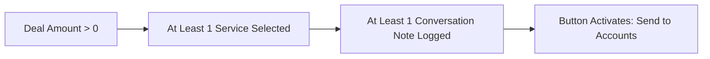

# Troubleshooting Handover and Progression Blockers

Amuwa AI CRM enforces strict validation rules at every workflow handoff to prevent incomplete dossiers from progressing to downstream teams. When a progression button is disabled (greyed out), inspect the specific prerequisites detailed below.

---

## Where to Find the Exact Blocker Reason

The CRM displays the precise blocking condition directly in the user interface:

> [!TIP]
> **Check the Reason Notice:**
> Look directly below the disabled button. An amber notice (`data-testid="send-reason"`) explicitly states why the action is blocked (e.g., *"Client portal login must be created before handover"* or *"3 required documents missing"*).

---

## 1. Blocker: "Send to Accounts" Button is Disabled

### Required Checklist
- [ ] **Deal Amount:** The `dealAmount` field must be greater than ₹0.
- [ ] **Services Selected:** At least one catalog offering must be selected and checked.
- [ ] **Conversation Note:** You must have logged at least one conversation note (`lead_conversations`) recording client agreement.

---

## 2. Blocker: "Send to Technical Consultant" is Disabled (Sales Panel)

### Required Checklist
- [ ] **Accounts Payment Confirmed:** Accounts must have audited and confirmed the payment (`accountsConfirmedAt` is not null). If payment is still pending in Accounts, Sales cannot forward the card.
- [ ] **Mandatory Checklist Items Complete:** Every required checklist item (excluding consultant-specific items like WABA ID) must have a saved value or uploaded document.
- [ ] **No Unresolved Rejections:** If the customer was previously returned by TC with items marked *Not authorized*, replacement files must be uploaded.

---

## 3. Blocker: "Send to Department Head" is Disabled (TC Panel)

### Required Checklist
- [ ] **All Documents Authorized:** `itemsVerified >= itemsTotal`. Every uploaded file must display the green `✓ Authorized` pill.
- [ ] **Zero Rejections Remaining:** `itemsRejected === 0`. If any item was marked *Not authorized*, you must either return the card to Sales or re-verify a replacement document.
- [ ] **Consultant Items Filled:** Technical fields assigned to the consultant (such as provisioned WABA ID or Website URL) must be filled and saved.
- [ ] **Client Portal Login Provisioned:** You must have generated and saved the customer's portal credentials in the **Client panel login** card.
- [ ] **Not Waiting on Sales:** The customer cannot be in `WAITING_ON_SALES` status (`returnedAt` must be null).

---

## 4. Blocker: "Pass to Team Lead" is Disabled (Department Head Panel)

### Required Checklist
- [ ] **Active Team Leads in Department:** At least one active staff member with role `TEAM_HEAD` must exist in your department's roster.
- [ ] If no Team Lead exists, contact **Super Admin** to create or promote a senior squad member to Team Lead.
