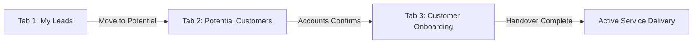

# Troubleshooting Missing Records and Permission Boundaries

When an employee cannot find an expected lead, customer card, or invoice, the issue is almost always related to **pipeline stage movement**, **ownership assignment**, or **departmental isolation rules**.

---

## 1. Symptom: "The lead disappeared after I updated it"

### Likely Cause: Pipeline Stage Movement
When you set a deal amount and advance a lead to **Potential**, or when Accounts confirms a deposit and moves a customer to **Customer Onboarding**, the card leaves its previous tab:

### Resolution Steps
1. In the Sales panel, click **2 Potential Customers** to see leads with agreed deal amounts.
2. If the customer already paid, click **3 Customer Onboarding**.
3. Use the global search shortcut (`Ctrl + K`) and type the customer's phone number or business name to locate their record regardless of active stage.

---

## 2. Symptom: "I cannot find a customer assigned to my squad"

### Likely Causes
- **Individual vs Squad Filter:** You may be viewing your personal queue rather than the squad queue.
- **Ownership Assignment:** The lead was assigned to a different team member or remains in the unassigned Inbound pool.

### Resolution Steps
1. If you are a Team Lead or Manager, toggle the view filter from **Mine** to **All Squad Members**.
2. Check the **Inbound Leads** tab (`/leads/inbound`) to see if the record has not yet been claimed.
3. If an account was reassigned by a Department Head, check your notifications for ownership transfer alerts.

---

## 3. Symptom: "Access Denied / Department Restricted"

### Likely Causes
Amuwa AI CRM enforces strict divisional data boundaries. A staff member assigned to Wabastore cannot view customer dossiers or invoices belonging to Digitree Infotech or Amuwa Design Studio.

### Resolution Steps
1. Verify the entity with which the customer contracted.
2. If cross-departmental collaboration is required (e.g., adding a Design Studio add-on to a Wabastore client), route the request through the **Add-ons Services** module rather than attempting direct cross-department navigation.
3. Super Admins can reassign employee departmental mappings if a specialist transferred permanently to a new division.
